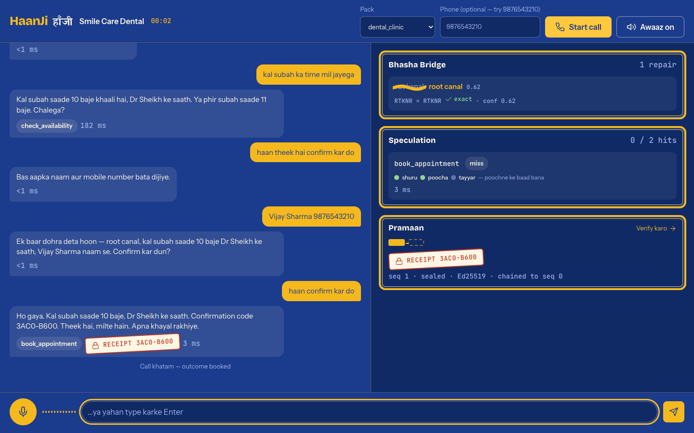
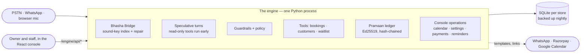

# HaanJi

[](https://github.com/aritra-25hazra/haanji/actions/workflows/ci.yml)
[](https://haanji-engine.onrender.com)
[](https://haanji-kappa.vercel.app)

[](https://github.com/aritra-25hazra/haanji/actions/workflows/security.yml)
[](https://codespaces.new/aritra-25hazra/haanji?quickstart=1)


<p align="center">
  <a href="https://haanji-engine.onrender.com/talk"></a>
</p>

**An AI voice receptionist for Indian small businesses.** It answers the phone in
Hinglish, books the appointment, and can prove afterwards exactly what the caller
agreed to.

Most small clinics, salons and labs in India lose bookings for one boring reason:
nobody picks up. The front desk is with a patient, it is lunch time, it is Sunday.
The caller does not leave a voicemail — they call the next place. HaanJi answers
every one of those calls, in the language the caller actually speaks, and writes
the booking straight into the business's calendar.

Three things in here are not in any product we could find, and each one is
implemented, measured and testable rather than described:

| | What it is | What it is worth |
|---|---|---|
| **Bhasha Bridge** | A per-tenant phonetic index built from the business's own catalogue, used both to bias the recogniser and to repair its output — but only when the recogniser was unsure *and* the sound key matches exactly. | Entity error rate **30.9% → 0.9%** at 30% recognition noise, with **zero** harmful corrections over 4,050 sentences. |
| **Speculative Turn Execution** | Branch prediction for dialogue. Read-only tools are predicted from partial transcripts and executed while the caller is still speaking; the result is used only if the real turn asks for byte-identical arguments. | Median latency on read turns **235 ms → 124 ms**, a 47.2% reduction, with a 41.9% prediction hit rate. |
| **Pramaan Ledger** | Every write is sealed into an Ed25519-signed, hash-chained receipt that binds the action to the caller's recorded confirmation. Daily Merkle anchors; an independent verifier. | **80/80** single-field tampering attempts detected; deletion and forgery detected; **0** unconfirmed writes accepted. |

Every number above was produced by `python -m haanji.bench` on this repository and
is written to [`research/results.json`](research/results.json). Nothing in this
README is an estimate. The full evaluation, with confidence intervals over five
seeds, baselines, related work and threats to validity, is in
[`research/REPORT.md`](research/REPORT.md) ([PDF](research/REPORT.pdf)); a
condensed paper draft is [`research/PAPER.md`](research/PAPER.md). For a viva:
[docs/viva.md](docs/viva.md) (fifty questions, three-line answers, where the
evidence is), [docs/competitors.md](docs/competitors.md),
[docs/diagrams.md](docs/diagrams.md), [docs/failure-gallery.md](docs/failure-gallery.md).

## See it live

| | | |
|---|---|---|
| **Landing** | https://haanji-engine.onrender.com | a real call replayed in the hero |
| **Talk to HaanJi** | https://haanji-engine.onrender.com/talk | your mic (Chrome) or typed lines, with the engine's three pieces live beside the transcript |
| **WhatsApp simulator** | https://haanji-engine.onrender.com/whatsapp | same brain over chat, plus missed-call recovery |
| **Public verifier** | https://haanji-engine.onrender.com/verify | every hash and signature re-checked in your browser |
| **Owner console** | https://haanji-kappa.vercel.app | dashboard, calls, Pack Studio |
| **Demo video** | *coming — see [docs/demo-script.md](docs/demo-script.md)* | 90 seconds |

The engine runs on a free instance; the first visit after a quiet spell can take
~20 s to wake.

### A sixty-second tour

1. Open the landing page and let the hero play — it is the README's own
   transcript, replayed. Hover to pause it.
2. **Baat karke dekho → Start call**, then type
   `haan ji mujhe rut kanal karwana tha`. The misheard words are painted over;
   the **Bhasha Bridge** card shows the two sound keys that matched and the
   recogniser's confidence that allowed the repair.
3. `kal subah ka time mil jayega` — the **Speculation** card shows
   `check_availability` and whether its answer was ready before it was asked for.
4. `haan theek hai confirm kar do` → `Vijay Sharma 9876543210` →
   `haan confirm kar do` — a receipt stamps the reply and the **Pramaan** chain
   grows by one block.
5. Open `/verify`, load this server's export, then press **Ek field chhedo** —
   the chain breaks at the edited receipt, and nothing left your browser.

<p align="center"></p>

---

## Try it in one minute

**Zero install:** [open the repository in GitHub Codespaces](https://codespaces.new/aritra-25hazra/haanji?quickstart=1).
The dev container installs the engine and the console, starts both, and
forwards the demo (port 8090) and the console (port 5173) to your browser.


```bash
cd engine
pip install -e ".[dev]"

python -m haanji.cli demo          # one narrated call, at real speaking speed
python -m haanji.cli selftest      # all 44 packaged scenarios, all ten packs
pytest -q                          # 581 tests
python -m haanji.bench             # regenerates research/results.json
```

No API keys, no network, no database. The mock providers stream partial
transcripts with per-word confidences at a realistic speaking rate, which is
exactly the signal the speculation engine consumes, so the demo exercises the
real code path rather than a simulation of it.

`make demo`, `make test`, `make bench` do the same from the repository root.

### Try it in a browser

```bash
pip install -e ".[web]"
python -m haanji.cli serve         # http://localhost:8090
```

One process, still no keys, gives you the whole platform:

| Page | What it shows |
|---|---|
| `/talk` | **Talk to HaanJi** — speak into your mic (Chrome/Edge), watch partial transcripts drive speculation live, interrupt it mid-sentence |
| `/whatsapp` | **WhatsApp simulator** — the same brain over text, plus a *missed call* button that triggers the recovery flow |
| `/verify` | **Public Pramaan verifier** — re-checks every hash and signature *in your browser*; a tamper button proves it isn't decorative |
| `/` | Landing page linking everything, plus `/api/insights` — outcomes, peak hours, recovered revenue, and a costed ₹/call comparison |

The React console (`cd console && npm run dev`) proxies to this server: the
dashboard shows live insights, the calls list shows live conversations, and
**Pack Studio** edits a Vertical Pack in the browser, validates it, and runs its
scenarios before saving.

### In VS Code

Open this folder in VS Code and everything is pre-wired: **Run and Debug** has
configurations for the demo call, the server, selftest and the benchmark;
**Terminal → Run Task** has install/test/serve tasks for both engine and
console (`.vscode/`). How three of us work on this repo from three machines at
three different hours is written down in [CONTRIBUTING.md](CONTRIBUTING.md).

---

## What a call looks like

```
AGENT  Haanji, Smile Care Dental. Main aapki kya madad karun?

HEARD  haan ji mujhe rut kanal karwana tha
       ~ Bhasha Bridge: 'rut kanal' -> 'root canal' (recogniser confidence 0.32)
CALLER haan ji mujhe root canal karwana tha
AGENT  Theek hai. Kis din ka time dekhun?                      . 22 ms

HEARD  kal subah ka time mil jayega
       > tool check_availability  [speculated, already computed]
AGENT  Kal subah saade 9 baje khaali hai, Dr Sheikh ke saath.
       Ya phir subah saade 10 baje. Chalega?                   . 31 ms
...
HEARD  haan confirm kar do
       > tool book_appointment
AGENT  Ho gaya. Kal subah saade 9 baje, Dr Sheikh ke saath.
       Confirmation code 2504-7863.                            . 301 ms

PRAMAAN LEDGER
  receipt 2504-7863   action book_appointment   seq 1
  caller was asked : Ek baar dohra deta hoon — root canal, kal subah saade 9
                     baje Dr Sheikh ke saath, Vijay Sharma naam se. Confirm kar dun?
  caller replied   : haan confirm kar do
  verifier says    : VALID — 1 receipts, chain intact

  someone edits the booking time '09:30' -> '18:00' in the database
  verifier says    : BROKEN at seq 1: payload hash does not match the stored content
```

---

## Repository layout

```
.
├── engine/          Python 3.11 voice engine — the runnable centrepiece
│   ├── haanji/
│   │   ├── bhasha/          phonetics, tenant lexicon, the correction bridge
│   │   ├── speculation/     predictor, claim-once cache, speculation engine
│   │   ├── pramaan/         receipts, ledger, independent verifier
│   │   ├── adapters/        STT / LLM / TTS boundaries + offline mock providers
│   │   ├── backend/         the business system the agent acts on (SQLite)
│   │   ├── tools/           the eight actions, with purity and confirmation flags
│   │   ├── channels/        WhatsApp (Meta Cloud API) + telephony webhook adapters
│   │   ├── web/             landing · Talk · WhatsApp sim · verifier — the Signboard design system, vanilla JS
│   │   ├── policy.py        the deterministic dialogue policy
│   │   ├── pipeline.py      the turn controller — where the three ideas meet
│   │   ├── guardrails.py    what the agent must never do
│   │   ├── server.py        FastAPI demo server — every channel on one port
│   │   ├── insights.py      outcome/revenue/cost analytics behind /api/insights
│   │   ├── bench.py         the evaluation harness that produces every number
│   │   └── cli.py           demo · selftest · bench · verify · serve · packs
│   └── tests/               581 tests, including the safety properties and the demo pages
│   │   ├── admin.py         the console's operations: calendar, customers, settings, waitlist, payments, backup
│   │   ├── reminders.py     the day-before WhatsApp reminder and the "1 / 2" replies
│   │   ├── payments.py      deposit links (Razorpay, or this server's mock), the signed webhook
│   │   └── backup.py        consistent SQLite backups, nightly to S3, restore on boot
├── console/         React 18 + TypeScript operator console (Vite): calendar, customers, settings, Pack Studio
├── experimental/    the Java control plane that nothing calls — kept as a reference, out of the stack
├── packs/           ten Vertical Packs — the commercial moat, as YAML
├── research/        results.json, regenerated by the harness
├── docs/            design spec + plan for the demo pages, media, the demo video script
└── ops/             Prometheus scrape config and the four real alerts
```

---

## The three contributions, in more detail

### Bhasha Bridge — the business's own words, indexed by sound

A general recogniser has never heard of *Bhawarkuan*, or of Dr Sheikh, and it
mangles *root canal* into *rut kanal* on a bad line. But the business already
told us its services, its staff and its neighbourhood during onboarding. Bhasha
Bridge turns that into a phonetic index using rules chosen for Indian English —
v/w merge, s/sh merge, aspirates weaken, long vowels shorten, word-initial
vowels bucket together because a weak /h/ is dropped by speakers and recognisers
alike.

The index is used twice: as biasing hints sent into the recogniser, and as a
post-correction pass over its output. The correction is where the care is. A
token is only replaced when **two independent conditions** hold:

1. the recogniser was **not confident** about it (below 0.85), and
2. its phonetic key matches a lexicon form **exactly**, within a small edit
   distance of that form.

Either condition alone produces false corrections, and a layer that damages a
good transcript is worse than no layer at all. Personal names the caller has just
introduced are never touched — "mera naam Wijay hai" stays *Wijay*, even though
*Vijay Nagar* is in the lexicon.

Measured over 4,050 independently corrupted sentences at three noise levels:

| noise | entity error, off | entity error, on | reduction | precision | harmful |
|---|---|---|---|---|---|
| 15% | 17.8% | 0.38% | 97.9% | 99.2% | 0 |
| 30% | 30.9% | 0.91% | 97.1% | 99.3% | 0 |
| 45% | 48.6% | 1.62% | 96.7% | 99.2% | 0 |

Median cost: **0.08 ms** per utterance.

Against the classic keys, with the lexicon, the two-condition rule and the
edit-distance bound held fixed (entity error *after* correction; synthetic at
30% noise, and the real-recogniser pilot):

| keyer | synthetic @30% | real pilot | harmful (real) |
|---|---|---|---|
| edit distance only | 1.45% | 31.1% | 6 |
| exact spelling | 32.18% | 33.3% | 0 |
| Soundex | 4.15% | 30.1% | 0 |
| Metaphone | 8.08% | 31.1% | 0 |
| NYSIIS | 3.24% | 32.0% | 0 |
| Double Metaphone | 6.78% | 30.1% | 0 |
| Bhasha (ours) | 0.88% | 29.2% | 0 |

Every pairwise McNemar test against ours on the synthetic data has p < 0.001 (p = 0.007 against the edit-distance bound alone);
on real recogniser output the keys are within a point of each other and the
safety rule matters more than the key. The per-rule ablation and the tests
are in the report (§4.6–4.7, `research/baselines.json`).

The corruption model in `haanji/corrupt.py` is written independently of the
lexicon and corrupts words that appear in no lexicon at all, so the harness can
catch the layer doing damage. It never has.

### Speculative Turn Execution — branch prediction for a conversation

By the time a caller has said "kal subah root canal ka…", it is nearly certain
the next thing needed is the availability for root canal tomorrow. A CPU in this
position starts executing the likely branch. So does HaanJi: partial transcripts
drive a cheap predictor, and read-only tools begin running while the caller is
still talking.

The speed is easy. Correctness is the work, and rests on four properties, each
with a test that fails loudly if it is weakened:

* **Purity** — only tools declared `read_only` are ever speculated. Enforced in
  the tool registry, not trusted to the predictor.
* **Argument identity** — a speculative result is claimed only when the real
  turn asks for byte-identical arguments. Both sides derive arguments through
  the same `haanji/nlu.py`, which makes the identity structural rather than
  lucky.
* **Freshness** — results expire after 4 s and can be claimed exactly once.
* **Invalidation** — any write voids everything computed against the old world.

There is also a budget: at most 2 in flight and 3 per turn, so a wrong guess
costs bounded work and never costs correctness. `test_the_result_is_identical_
with_speculation_on_and_off` asserts the strong form of this — the transcript of
the call must be identical whether speculation is on or off, because it is a
latency optimisation and nothing else.

Measured: **235 ms → 124 ms** median on read turns (47.2% lower), 41.9% hit rate
over 155 speculations, 219 ms saved per hit. Write turns are never speculated, so
the booking turn itself is not faster: its p90 is 197 ms without
speculation and 200 ms with it — reported rather than averaged away.

### Pramaan Ledger — proof, not logs

"The AI booked it" is not an answer when a customer disputes an appointment. Every
write in HaanJi produces a receipt containing the action, its arguments, the exact
sentence the agent asked, the exact words the caller replied, how long after the
question the reply began, and the recogniser's confidence in it. The receipt is
hash-chained to its predecessor and signed with the tenant's Ed25519 key; days are
anchored with a signed Merkle root.

Two consequences that a log file cannot give you:

* **The ledger refuses an unconfirmed write.** `book_appointment` without a
  confirmation proof raises, the surrounding transaction rolls back, and no
  booking exists. The engine cannot book something the caller did not agree to,
  even if the dialogue policy has a bug.
* **Anyone can check it.** `/api/v1/receipts/export` returns the receipts and the
  public key and nothing else; `haanji verify` re-derives every hash and checks
  every signature without trusting the platform.

Measured: 80 of 80 single-field mutations detected across eight different fields;
receipt deletion detected; a forged receipt re-hashed by an attacker still fails
the signature; 0 unconfirmed writes accepted.

### Vertical Packs — why this is a product and not a demo

A pack is one YAML file that describes a *kind* of business: catalogue, hours,
staff, persona, refusals, escalations, seed vocabulary, knowledge base, and the
scenarios the pack must pass before it ships. Ten are included: a dental
clinic, a salon and spa, a diagnostic lab and a coaching institute in
Hinglish; a dental clinic in Kolkata that speaks **Benglish**; a clinic in Pune
(**Marathinglish**); and, since 1.1, a dental clinic in Chennai
(**Tanglish**), a diagnostic lab in Hyderabad (**Tenglish**), a coaching
institute in Ahmedabad (**Gujlish**) and a salon in Ludhiana (**Punglish**).

The Kolkata pack was the proof of the whole claim, and the six packs that
followed it are the same proof repeated. Supporting a language takes a
phrase-table row in `speak.py`, the caller's words in `nlu.py` and one YAML
file — surface forms, vocabulary, scenarios. Zero engine code was forked: the
same extractor resolves "porshu bikel char te", "naalai kaalai pathu mani"
and "udya sakali daha vajta" the way it resolves "kal subah das baje", and the
agent replies in kind ("Aapnar naam ta bolben?", "Unga peru enna?"). Nothing in
the engine knows what a dentist is, and nothing in it knows what Hindi is
either. Onboarding a business is filling in a pack; supporting a new industry
— or a new city — is writing one. The collisions a new language brings
("sare" is Telugu for *ok* and Hindi for *half*; "nai" is Punjabi *no* and
Hindi *new*) are decided one word at a time and pinned by tests.

---

## The platform around the engine (v0.4)

The engine answers a call. A business needs the rest of the loop, and each piece
below is running code behind `haanji serve`, not a slide:

* **Talk to HaanJi** — a browser call at `/talk`: your microphone, live partial
  transcripts, barge-in, and the speculation/repair badges lighting up as they
  happen. The demo is the product.
* **WhatsApp channel** — the identical pipeline over text (`NullTTS`, same
  policy, same guardrails, same receipts). A real Meta Cloud API adapter ships
  in `channels/whatsapp.py`; the simulator at `/whatsapp` runs it keyless.
* **Missed-call recovery** — the Indian classic: caller gives a missed call, the
  platform messages them back on WhatsApp and finishes the booking in chat.
  Recovered bookings are counted separately in insights, because "revenue that
  would have been lost" is the number a shop owner buys.
* **Returning-caller memory** — "Vijay ji, wapas swagat hai! Pichhli baar root
  canal karaya tha." The greeting, the pre-filled phone number, and the shorter
  question path all come from the store, per tenant.
* **AI insights** — `/api/insights` turns the call log into sentences an owner
  acts on: outcomes, peak hours, top services, recovered revenue, and a costed
  comparison (about **₹3.2/call** for AI versus **₹9.2/call** for a
  ₹12,000/month receptionist at 50 calls/day — every constant is in
  `insights.py`, argue with the constants, not the arithmetic).
* **Pack Studio** — the console page where a pack is edited as YAML, validated,
  and its scenarios run against the live engine *before* saving. Selling a
  vertical becomes a form, not a deployment.
* **Public verifier** — `/verify` re-derives every SHA-256 and checks every
  Ed25519 signature client-side (Web Crypto + vendored TweetNaCl). The page has
  a *tamper* button; press it and watch the chain break. A trust claim you can
  only check on our server would not be a trust claim.

### Running it for a real shop

Everything below is in the engine and the console today; most of it is a
switch in `render.yaml`.

* **Live feed.** The console's *Abhi* panel shows every call as it happens —
  the caller's words while they are still speaking, each repair, tool,
  speculation hit and receipt — over server-sent events (`/api/events`), with
  a polling fallback for proxies that buffer.
* **Sign-in and staff.** `HAANJI_AUTH=on` puts the owner console behind a
  WhatsApp one-time code; owners edit, staff read, and each user sees only
  their packs. The demo stays public. [docs/console-auth.md](docs/console-auth.md).
* **Onboarding in five answers.** *Nayi dukaan* turns a business name, type,
  staff, hours and a service list into a complete pack (persona, guardrails
  for that kind of business, knowledge base, two generated scenarios), runs
  the scenarios, and opens a test call. Pack Studio can keep editing the YAML.
* **The customer's own proof.** Every receipt reaches the customer as a link
  to the public verifier; the day's receipts are sealed as a signed Merkle
  root (`/api/anchors`) and published every evening to this repository's
  `transparency` branch. `/transparency` explains how to check one by hand.
* **The owner's evening WhatsApp.** Calls, bookings, revenue, callbacks and
  the busiest hour, previewed on the dashboard and sent at
  `HAANJI_DIGEST_HOUR` to `HAANJI_OWNER_PHONE`.
* **Ops.** Prometheus metrics at `/metrics` (the names `ops/alerts.yml` pages
  on), per-turn traces (bhasha, dialogue, each tool, speculated or not), and an
  *Ops* page with the 1,500 ms objective, a latency histogram and the latest
  call as a waterfall. Grafana is provisioned in `docker compose`.
* **Load.** One engine process, mock providers, scripted callers over the
  web-call API (`research/harness/load_test.py`):

| concurrent callers | turn p50 (ms) | turn p95 (ms) | calls/min | errors |
|---|---|---|---|---|
| 5 | 6.9 | 188.5 | 457 | 0 |
| 10 | 5.6 | 185.0 | 786 | 0 |
| 25 | 3.9 | 183.8 | 1399 | 0 |
| 50 | 6.1 | 185.8 | 2146 | 0 |

  Latency does not move with concurrency; the p95 is the booking turn's
  write and ledger seal. The engine spends 0.0085 CPU-seconds per call,
  ≈ ₹0.000000 on a ₹600/month instance; the speech vendors are the cost. The "expected outcome" rate in
  [`research/load_test.json`](research/load_test.json) falls from 97% to 70%
  across the ladder because sixty scripted callers book the same morning in
  one shared calendar and the script does not take the alternative the agent
  offers — the calendar filling is correct behaviour, not an error.
* **Rescheduling.** "Meri booking parso shaam ko shift kar do": the booking
  is found by number, re-slotted through the ordinary flow, and sealed as one
  receipt that names the previous booking and its receipt — outcome
  `RESCHEDULED`, on every channel.
* **Human takeover.** From the dashboard's live panel, *Mujhe do* takes a
  running call — web, WhatsApp or phone — away from the agent; the person's
  typed replies are spoken on the line, sent on WhatsApp or shown in the
  browser, and recorded as human turns; *Wapas agent ko* hands it back.
* **Notifications and an installable console.** *Notifications on* subscribes
  the owner's phone to web push (VAPID keys generated beside the data); a
  booking, a reschedule, a callback or a handoff buzzes it with a link to the
  call. The console has a web-app manifest and a service worker, so it
  installs to the home screen.
* **Hindi-script input.** A recogniser running in Hindi mode may send
  Devanagari; the engine transliterates it before the pipeline, so the same
  lexicon, extractor and policy answer.
* **Devanagari.** A हिंदी toggle on `/talk` and in the console's call view
  shows the transcript in Devanagari (an approximate, dictionary-plus-rules
  transliteration; the engine labels it so).
* **Design system.** `/design` documents Signboard — the colours, type, icons,
  motion rules and components every page is built from.
* **A real phone number.** `engine/haanji/telephony/` bridges Twilio Media
  Streams to the engine: Deepgram hears the caller (partials feed
  speculation, finals the policy, as in the browser), ElevenLabs speaks the
  reply as telephone audio, and a caller who talks over the agent clears the
  line (barge-in). Tested end to end with fake vendors; three keys make it
  real — [docs/phone-setup.md](docs/phone-setup.md).
* **Calendars.** A per-tenant iCalendar feed any calendar app subscribes to,
  a `.ics` for each booking, and a Google Calendar connection that creates an
  event for every sealed booking (OAuth 2.0 in the console's Calendar panel).
* **Your own domain.** [docs/custom-domain.md](docs/custom-domain.md) lists
  the DNS records and the six places the URL lives.
* **Privacy (DPDP Act 2023).** Personal fields inside receipts are encrypted
  per customer; erasure shreds the key, so the ledger stays verifiable and the
  data unreadable. Access and erasure endpoints, a console button, a consent
  line, retention purge — [docs/privacy-dpdp.md](docs/privacy-dpdp.md).
* **Security.** CodeQL, secret scanning, dependency audits and an SBOM on
  every push; rate limiting and hardening headers on the demo server. The
  ledger's properties and threat model are written down and property-tested
  ([docs/pramaan-security.md](docs/pramaan-security.md)).
* **Languages.** Hinglish, Benglish (Kolkata), Marathinglish (Pune), and in
  1.1 Tanglish (Chennai), Tenglish (Hyderabad), Gujlish (Ahmedabad) and
  Punglish (Ludhiana): a phrase-table row and one YAML file each.

### What a receptionist does besides answering (1.1)

The 2026-10-29 review of this repository found that the engine understood
scripted callers and misheard real ones: "saade das" booked 10:00, "15
tarikh" booked tomorrow, "kal shaam ko" got a morning slot, "nahi parso"
ended the call, "Dr Iyer se" booked Dr Sheikh, a discount question was told
it had an emergency. Every one of those is now a test
(`engine/tests/test_phase_g.py`), and the same release adds what a shop
actually pays a receptionist for:

* **Reminders.** The evening before, every booking with a number gets a
  WhatsApp message; **1** confirms, **2** cancels — through the ledger, with
  the reminder as the question and the reply as the proof.
* **Deposits.** `deposit_inr` in the pack's settings puts a payment link in
  every confirmation (Razorpay Payment Links with keys; a one-click mock page
  on this server without). A paid deposit is sealed as `payment_received`.
* **Waitlist.** A caller who wanted a full day is on that day's waitlist; a
  cancellation — by a caller, a reminder reply or the console — offers the
  freed slot to the first person waiting, and "haan" books it.
* **The console is an operator's.** A calendar (day / week, cancel, no-show,
  completed — each sealed as a staff action), customers, per-pack settings,
  staff management, waitlist and payments ([docs/console-api.md](docs/console-api.md)).
* **Groups, doctors, exact times.** "Mujhe aur meri wife ko" books two seats
  under one receipt; "Dr Iyer se" books Dr Iyer; "saade das" is checked as
  10:30 before any details are asked, with alternatives when it is taken.
* **Who may cancel.** A number typed into a web page is not proof of
  anything: cancelling or moving a booking from the web needs the receipt
  code the customer was given. A number the channel vouched for (caller-id,
  the WhatsApp sender) does not. Receipts record which.
* **Backups.** Consistent SQLite backups of everything, nightly to
  S3-compatible storage when configured, restored on boot into an empty data
  directory, downloadable by the owner ([docs/operations.md](docs/operations.md)).
* **Security.** The review's findings — an erasure endpoint that could wipe
  a tenant, "no `?pack=`" meaning "any pack", public ops and simulator
  routes, unbounded bodies, OTPs that could be brute-forced, tokens that
  could not be revoked — are fixed and tested ([CHANGELOG](CHANGELOG.md)).

### A real model behind the same boundary

`HAANJI_PROVIDER_LLM=claude` puts Claude (`claude-opus-4-8` by default) behind
the dialogue boundary instead of the deterministic policy. The model decides
what to say and which read-only tools to run; it never decides when something
is written. A request to book or cancel is turned into the pack's own read-back
question, and the caller's *yes* is handled by the deterministic policy — the
only path that produces a tool call the ledger will accept. If the API is
unreachable, that turn falls back to the policy and the call carries on.

```bash
pip install -e ".[dev,web,llm]"
echo "ANTHROPIC_API_KEY=..." > engine/.env     # gitignored; never committed
haanji selftest --llm claude                  # the 44 scenarios, with a model talking
```

`research/harness/llm_ablation.py` runs the scenarios under both providers and
reports outcome, latency, speculation hit rate, fallbacks and token use side
by side. The guarantees do not depend on which one answers.

---

## Architecture



One process serves every channel and the console. Everything durable is in
SQLite files under the data directory — one per concern (bookings per pack,
ledger per pack, calls, auth, vault, settings, payments) — backed up
consistently with SQLite's online backup API and restorable on boot. Tenant
isolation is by pack id on every row and every route: a request whose pack
cannot be determined is denied, never defaulted to "any".

The Java control plane that an earlier design put in front of the engine is
in [`experimental/`](experimental/README.md): nothing in the running system
ever called it, and the compose stack no longer starts it.

---

## Running the whole system

```bash
docker compose up --build
```

| Service | URL |
|---|---|
| Engine (talk · whatsapp · verify · the console's API) | http://localhost:8090 |
| Console | http://localhost:5173 |
| Grafana | http://localhost:3000 (admin / haanji) |
| Prometheus | http://localhost:9090 |

The engine's data lives on the `engine-data` volume, so `docker compose down`
and a rebuild keep the bookings and the ledger.

The console runs standalone too (`cd console && npm install && npm run dev`); with
no token present it renders the sample dataset captured from the engine's demo run,
which is how the interface was designed and reviewed.

### Deployed

The live demo is the engine on Render (one Docker service from
[`render.yaml`](render.yaml), built from the repository root so the packs ship
inside the image) and the console on Vercel ([`console/vercel.json`](console/vercel.json)
proxies `/engine/*` to the engine, so the console stays same-origin). The engine
needs no database server. The free instance's disk is ephemeral: a redeploy
starts the demo clean, which is intended for the demo and is why a real shop
sets `HAANJI_BACKUP_S3_BUCKET` and `HAANJI_RESTORE_FROM`
([docs/operations.md](docs/operations.md)). A ten-minute GitHub Actions ping
keeps the free instance warm; delete
[`.github/workflows/keep-awake.yml`](.github/workflows/keep-awake.yml) to stop it.

---

## Honest notes

A project report should say what was verified and what was not.

* **The Python engine is fully executed here.** 581 tests, 44 scenarios across
  ten packs and seven languages, and the entire benchmark run on this
  machine. Every number in this README comes from that run.
* **The React console builds here.** `npm run build` type-checks the whole
  TypeScript source under `strict` and emits a production bundle.
* **The Java control plane is not part of the system.** It builds and its 16
  tests pass in CI, but nothing calls it; it was moved to
  [`experimental/`](experimental/README.md) in 1.1 with its gaps written down
  rather than described as the durable layer it never became.
* **The demo pages were redesigned in October 2026** — the "Signboard" direction,
  drawn from hand-painted Indian shop signs. The design decisions, the token
  system and the page-by-page plan are in [`docs/superpowers/`](docs/superpowers/),
  and a Playwright + axe pass (`engine/tests/visual_check.py`) keeps them to
  WCAG 2 AA with no horizontal overflow at 390 px.
* **The browser call uses the browser's own recogniser.** `/talk` feeds Web
  Speech API partials and finals into the same pipeline the mock providers
  exercise; per-word confidence is not exposed by browsers, so the engine
  estimates it from its lexicon on that path. Chrome/Edge required for the mic;
  the type-a-line fallback works everywhere.
* **Providers are mocked by default.** Swapping in a hosted recogniser or model
  means replacing one adapter class; the engine imports no vendor SDK outside
  its adapters, and the one it ships (`adapters/claude.py`) is an optional
  extra that is only imported when it is configured. The latency figures are
  therefore engine-side: they measure what HaanJi adds and what speculation
  removes, not what a particular vendor charges in round-trip time.
* **A known collision is recorded rather than hidden.** /b/ and /p/ merge for many
  speakers, so *braces* and *prices* land in one phonetic bucket and the edit
  distance does not separate them either. The confidence condition is what keeps
  this from mattering in practice. `test_a_known_collision_is_documented_not_hidden`
  exists so the limitation cannot be quietly lost.
* **The corruption model is a model.** It reproduces the substitutions Indian
  English recognisers actually make, but it is not a recording of real callers.
  A pilot that ran synthetic Indian-English speech through Whisper
  (`research/collect/`, [`research/real_asr.json`](research/real_asr.json))
  found the bridge's confidence gate wide open on a real recogniser's
  probabilities and the layer making harmful corrections; two stated guards
  fixed that, and on that data the bridge reduces entity errors by about a
  tenth, not by 97%. The report's §4.5 says why. Three follow-ups on the same
  300 recordings ([§4.9–4.11](research/REPORT.md)): a merged-token rule adds
  two repairs; calibrating the confidence gate per recogniser does *not* help
  (Whisper's word probabilities are weakly informative, and a sweep shows the
  gate contributes nothing to safety on that data — the guards and the second
  condition do); and handing the pack vocabulary to the recogniser as its
  prompt halves entity error before any repair, which makes biasing the lever
  and the bridge the safety net behind it. Volunteer recordings go through
  the same pipeline (`/record`), and a small user study has its kit at `/study`
  ([protocol](docs/study/protocol.md)); neither has been run yet.
* **A learned speculation predictor was tried and not adopted.** Fitted on the
  harness's own partials it is more precise, less eager and slower at the
  median ([§5.4](research/REPORT.md)); the hand-set weights stay until partials
  from real calls exist.

---

## Install, cite, read

* **Install the engine alone:** `pip install "haanji-engine[web]"` — the ten
  packs are bundled; `HAANJI_PACKS_DIR` points it at your own. A GitHub
  release builds and checks the wheel (`publish` workflow) and uploads it to
  PyPI through trusted publishing once the repository variable `PYPI_PUBLISH`
  is `true`. ([CHANGELOG](CHANGELOG.md))
* **Cite:** [`CITATION.cff`](CITATION.cff) (GitHub's *Cite this repository*
  button reads it); a release on GitHub is archived on Zenodo with a DOI once
  the repository is linked there.
* **Read:** the documentation site is built from [`docs/`](docs/) by MkDocs
  (`make docs`) and published by the `docs` workflow; the report and the
  paper are in it. The paper is also in LaTeX, ready for a venue template:
  [`research/paper-latex/`](research/paper-latex/).

## Team

Aritra Hazra · Prabhav Upadhayay · Anuj Uniyal
B.Tech Information Technology (Artificial Intelligence), Medi-Caps University

## Licence

Apache-2.0. The engine, the packs and the verifier are open source on purpose: a
tamper-evidence claim nobody can inspect is not a claim.
