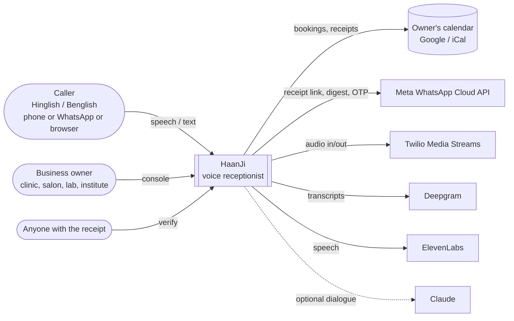
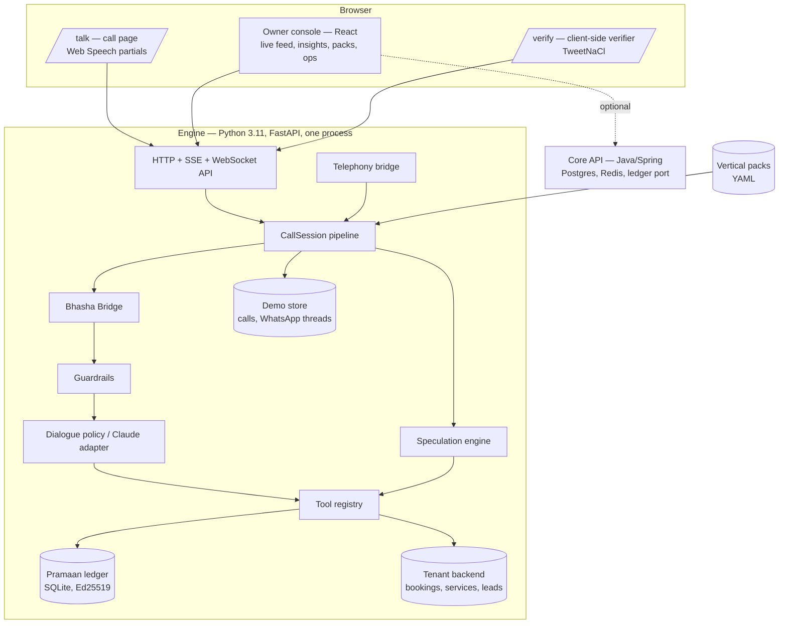
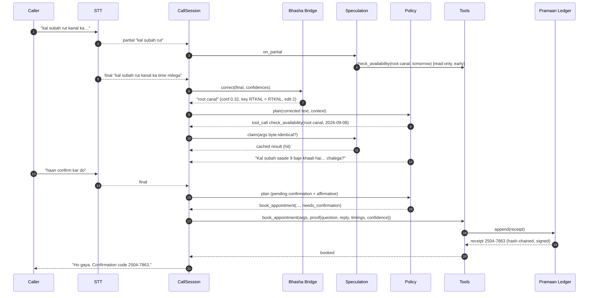
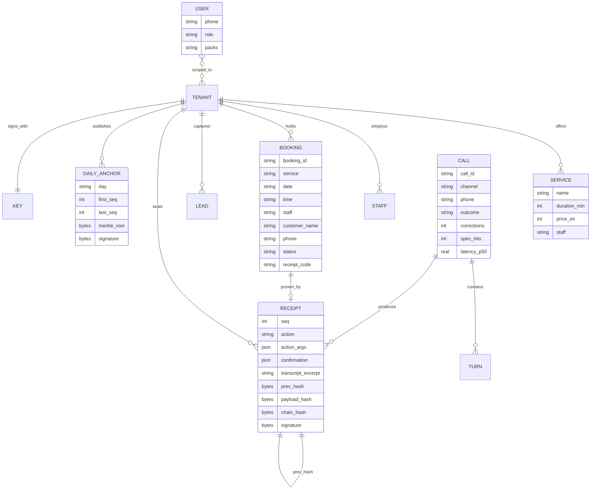
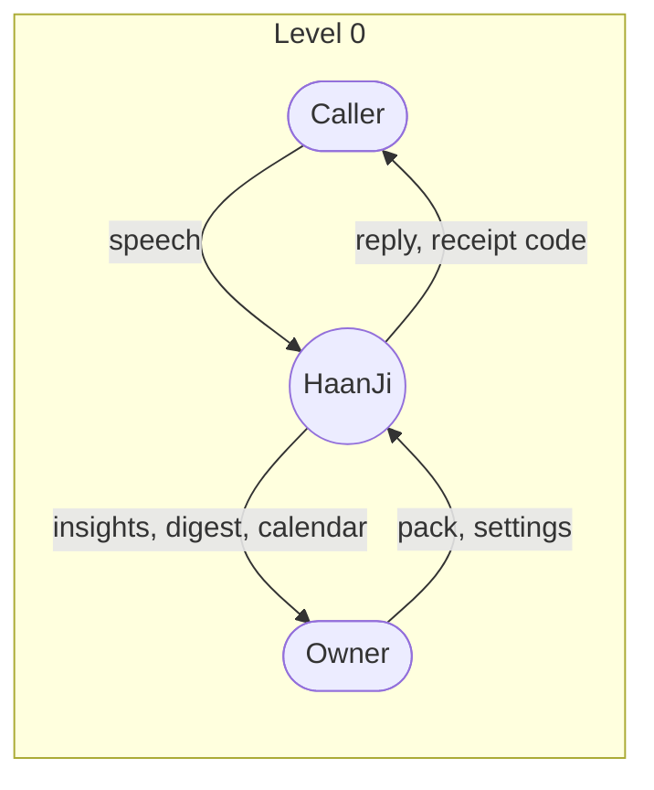
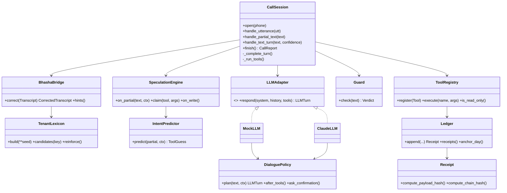
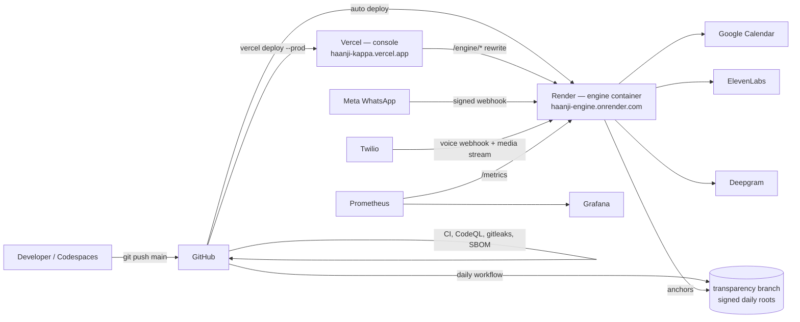

# Diagrams

The system as examiners expect to see it: context, containers, a booking turn,
the data, the data flow, the classes that matter, and the deployment. All
Mermaid, so they render on GitHub and in the PDF report.

## C4 — context



## C4 — containers



## Sequence — one booking turn (speculation, correction, confirmation, receipt)



## ER — the data



## DFD — level 0 and level 1



```mermaid
flowchart LR
  subgraph L1[Level 1 — one turn]
    a[(1.0 recognise)] --> b[(2.0 correct\nBhasha Bridge)]
    a -. partials .-> x[(3.0 speculate)]
    b --> g[(4.0 guard)]
    g --> d[(5.0 decide\npolicy / model)]
    d --> t[(6.0 execute tools)]
    x --> t
    t -->|write| l[(7.0 seal receipt)]
    d --> s[(8.0 speak)]
    D1[(lexicon)] --> b
    D2[(backend)] <--> t
    D3[(ledger)] <--> l
    D4[(call store)] <-- s
  end
```

## Class diagram — the engine's core



## Deployment


