# HaanJi: a voice receptionist for Indian small businesses that hears the business's own words, answers before the caller finishes, and can prove what was agreed

<p class="byline">Aritra Hazra · Prabhav Upadhayay · Anuj Uniyal<br>
B.Tech Information Technology (Artificial Intelligence), Medi-Caps University<br>
Evaluation report, version 1.0 · 15 October 2026 · code and data: <a href="https://github.com/aritra-25hazra/haanji">github.com/aritra-25hazra/haanji</a></p>

## Abstract

Small clinics, salons, laboratories and coaching institutes in India lose bookings because nobody answers the phone, and the callers who do get through speak Hinglish or Benglish and name services, doctors and neighbourhoods that no general-purpose speech recogniser has heard of. HaanJi is an open-source voice-agent engine built around three contributions that address the three reasons such an agent fails in practice. **Bhasha Bridge** builds a per-tenant phonetic index from the catalogue a business supplies at onboarding and uses it both to bias the recogniser and to repair its output, replacing a token only when the recogniser was unsure *and* the token's Indic-aware sound key matches a known form exactly. **Speculative Turn Execution** applies the idea of branch prediction to dialogue: read-only tools are predicted from partial transcripts and run while the caller is still speaking, and a speculative result is claimed only when the real turn requests byte-identical arguments. The **Pramaan Ledger** seals every write into an Ed25519-signed, hash-chained receipt that binds the action to the exact words with which the caller confirmed it, refuses writes that carry no such proof, and can be verified by anyone holding the public key. The contributions are evaluated with an ablation harness over 21 authored call scenarios in five vertical packs and two languages, repeated under 5 independent random seeds, and with a transcript-level experiment over 2,097 independently corrupted sentences per noise level. Against Soundex, Metaphone, Double Metaphone, NYSIIS and the edit-distance bound alone, with everything but the key held fixed, the Indic-aware key is the best on synthetic noise (every pairwise McNemar p < 0.001) and within a point of the classics on real recogniser output, where the safety rule matters more than the key. At 30% synthetic recognition noise Bhasha Bridge reduces the catalogue entity error rate from 32.4% to 0.71% (97.8% relative) with 98.9% correction precision and no harmful correction in any run, and raises end-to-end task success from 78.4% to 92.7%. Speculation lowers the median engine-side latency of read-only turns from 286 ms to 161 ms (43.8%) at a 46.2% hit rate without changing any transcript. The ledger detects 80 of 80 single-field tampering attempts, a deletion and a re-hashed forgery, and accepts zero unconfirmed writes. We also report the design and offline validation of a hosted-model dialogue adapter that preserves the ledger's guarantee by construction, A pilot of the real-recogniser pipeline (synthetic Indian-English speech through Whisper) found the bridge's confidence gate open and the layer making harmful corrections; three stated guards remove them, and on that data the bridge is safe and reduces entity errors by only a tenth, a result reported as it is. We state plainly what the evaluation does not yet cover: real callers, real users, and vendor round-trip time.

## 1. Introduction

### 1.1 The problem

A typical Indian neighbourhood clinic receives tens of calls a day and answers a fraction of them. The receptionist is with a patient, it is lunch time, it is Sunday. The caller does not leave a voicemail; they call the next clinic. An automated receptionist that could answer in the caller's own mix of Hindi and English, find a slot, and book it would recover that revenue directly, and the economics are not subtle: at the call volumes of a small business the engine's own cost model puts an AI-answered call at roughly a third of the cost of a human-answered one.

Building such an agent from a speech recogniser, a language model and a speech synthesiser is now routine. Making it *trustworthy enough to take a booking* is not, and the reasons are specific to this setting:

1. **The vocabulary that matters is the vocabulary the recogniser has never seen.** The words on which a booking turns, the service ("root canal", "keratin treatment", "lipid profile"), the doctor ("Dr Sheikh"), the locality ("Bhawarkuan"), are exactly the words a general recogniser mangles, and it mangles them in systematic, Indian-English-specific ways: v/w, s/sh, aspirates, long vowels, a dropped initial /h/. Text-level word error rate understates the damage, because an agent can tolerate a hundred wrong function words and not one wrong service name.
2. **Latency is felt at the turn, not on average.** A caller who asks "kal subah ka time milega?" and waits a second and a half in silence hangs up or talks over the agent. Most of that time is spent in tools (availability lookups, catalogue queries) that could have started before the caller finished the sentence.
3. **"The AI booked it" is not an answer.** When a customer disputes an appointment, a log line is worth nothing; the business needs evidence of what was asked and what was agreed, and the customer needs to be unable to be booked for something they never confirmed, even if the dialogue logic has a bug.

### 1.2 Contributions

HaanJi is a complete, deployed system (a Python engine, a Java core API, a React owner console and a set of YAML vertical packs), but this report is about the three mechanisms in the engine that are, to our knowledge, not found together in any existing product, and about the evidence for them:

* **Bhasha Bridge** (§4), a per-tenant phonetic index with an Indic-aware key and a two-condition correction rule designed so that the layer can never damage a transcript the recogniser got right.
* **Speculative Turn Execution** (§5), prediction and early execution of read-only tools from partial transcripts, with four enforced properties (purity, argument identity, freshness, invalidation) that make it a pure latency optimisation.
* **Pramaan Ledger** (§6), signed, hash-chained receipts that bind every write to the caller's recorded confirmation, with a refusal path for unconfirmed writes and an independent verifier.

A fourth, smaller contribution is methodological: the engine ships with a benchmark harness (§3.4) that produces every number in this report from a clean checkout with no network and no API key, and a corruption model written independently of the correction layer so that the harness can catch the layer doing harm.

### 1.3 What this report is and is not

This is a report on an engineering artefact and its measured behaviour. Every number comes from `research/harness/report_data.py`, which runs the harness under 5 seeds and reports means with 95% confidence intervals; the single-seed figures quoted in the project README come from `python -m haanji.bench` and agree with them. The recognition noise is synthetic, the callers are scripted, and the latencies are engine-side. §8 says what follows from that, and §9 describes the two studies (real recordings, real users) that are planned to close the gap.

## 2. Background and related work

**Contextual biasing in speech recognition.** End-to-end recognisers can be steered towards a list of phrases supplied at request time, either inside the model (contextual listen-attend-spell, Pundak et al. 2018) or by shallow fusion with a phrase-level language model at decode time (Zhao et al. 2019). Commercial speech APIs expose this as "phrase hints". Biasing improves recall of in-list phrases but does nothing after the fact, and it is only as good as the recogniser's willingness to honour the list. Bhasha Bridge sends the same lexicon as hints *and* keeps a post-correction pass, because in our setting the recogniser is a vendor black box that may ignore the hints, may not offer them at all (browser Web Speech API), and in any case reports a confidence we can use.

**Phonetic matching.** Soundex (Russell 1918) and its descendants Metaphone and Double Metaphone (Philips 1990, 2000) map spellings to sound keys so that variant spellings collide. They encode English phonology. Hinglish spoken by Indian callers and transcribed by Indian-English recognisers merges distinctions English keeps (v/w, s/sh, dental/retroflex) and keeps some English merges apart; standard Soundex therefore both over- and under-merges. The key in §4.1 is a small explicit rule set for this phonology, placed in source so that each rule is a stated, testable claim. Edit distance (Levenshtein 1966) is used as the second, surface-level condition.

**Code-mixed and Indian-accented speech.** Hindi-English code-mixing is the ordinary register of Indian urban speech (Bali et al. 2014). Recent datasets, IndicVoices (Javed et al. 2024) and the Svarah benchmark of Indian-accented English (Javed et al. 2023), document how far general recognisers, including Whisper (Radford et al. 2023), fall short on this speech, and particularly on named entities. These datasets are the natural next material for the correction layer (§9).

**Speculative execution.** Speculating on the likely branch and discarding the work if the guess is wrong is the oldest latency trick in computer architecture (Hennessy and Patterson 2017). It has recently been applied inside language-model inference as speculative decoding (Leviathan et al. 2023; Chen et al. 2023), where a cheap draft model proposes tokens that the large model verifies. Speculative Turn Execution applies the same shape one level up, at the dialogue turn: a cheap predictor proposes a tool call from a partial transcript, the tool runs early, and the real turn "verifies" by asking for identical arguments. The correctness argument is the same as in hardware: speculation must be side-effect-free and its results must be discarded unless the architectural path asks for exactly them.

**Tamper-evident logs.** Linking records by hash so that any alteration breaks the chain dates to Haber and Stornetta (1991); Merkle trees (Merkle 1987) make a set of records verifiable from one root; Certificate Transparency (Laurie, Langley and Kasper 2013) is the best-known deployment of a publicly verifiable append-only log. Ed25519 (Bernstein et al. 2012) provides small, fast signatures. The Pramaan Ledger is a conventional composition of these: per-tenant Ed25519 keys, a SHA-256 chain over canonical JSON (RFC 8785, Rundgren et al. 2020), and daily signed Merkle roots. What is new is not the cryptography but *what is sealed*: the receipt carries the agent's confirmation question and the caller's answer with timing and recognition confidence, and the ledger refuses to seal a write that carries no such confirmation.

**Confirmation in spoken dialogue.** Explicit confirmation before a consequential action, and the design of recovery from non-understanding, are long-standing concerns in spoken dialogue systems (Bohus and Rudnicky 2005; Skantze 2005). Task-oriented dialogue research measures success on benchmarks such as MultiWOZ (Budzianowski et al. 2018). HaanJi's dialogue policy is deliberately a deterministic state machine, with a hosted model as an optional, bounded replacement (§7); the confirmation step is never delegated to the model.

## 3. System overview

### 3.1 Architecture

```
caller audio ──▶ STT adapter ──▶ partial transcripts ──┬──▶ Speculation engine ──▶ read-only tools (early)
                                                        │
                                 final transcript ──▶ Bhasha Bridge ──▶ Guardrails ──▶ Dialogue adapter
                                                                                        (policy | Claude)
                                                                                             │
                                                                     tool calls ◀────────────┘
                                                                        │
                                              reads: claim speculation if args identical
                                              writes: Pramaan Ledger seals a receipt, or refuses
                                                                        │
                                                   reply ──▶ TTS adapter (cancellable on barge-in)
```

One pass through `CallSession.handle_utterance` is the whole hot path. The engine is 5,775 lines of Python 3.11 with no vendor SDK outside its adapters; speech and language providers sit behind three protocols and are mocked by default, which is what makes the evaluation reproducible offline. A Java core API (2,772 lines) ports the ledger and exposes the owner-facing REST surface; a React console (1,324 lines of TypeScript) reads the engine directly. The whole system is deployed (engine on Render, console on Vercel) and has run live calls through a browser and through a WhatsApp webhook.

### 3.2 Vertical packs

A pack is one YAML file describing a kind of business: catalogue with durations and prices, staff, hours, persona, refusals and escalations, seed vocabulary (places, brands, phrases), a small knowledge base, and the scenarios the pack must pass before it ships. Five packs are included:

| pack | language | services | staff | scenarios |
|---|---|---|---|---|
| dental_clinic | Hinglish | 6 | 3 | 8 |
| salon_spa | Hinglish | 6 | 4 | 4 |
| diagnostic_lab | Hinglish | 6 | 3 | 3 |
| coaching_institute | Hinglish | 4 | 3 | 3 |
| clinic_kolkata | Benglish | 4 | 2 | 3 |
| clinic_pune | Marathinglish | 4 | 2 | 3 |

The Kolkata and Pune packs are the test of the claim that the engine knows nothing about any particular language: supporting Benglish, and then Marathinglish, took a phrase-table row and one YAML file each, with no engine code forked. (The Pune pack was added after the evaluation runs below, which cover the first five packs and 21 scenarios; the selftest covers all 24.)

### 3.3 The dialogue policy and guardrails

The default dialogue policy is a deterministic state machine over the conversation context (service, date, time, staff, name, phone, pending confirmation). It is deterministic for three reasons that matter for a system that takes bookings: every decision is reproducible, so a regression is a bug and not a sampling accident; it is the thing the ledger audits; and it runs in microseconds, leaving the latency budget for the parts that need it. Guardrails run on the corrected transcript *before* the policy: each rule pairs a subject pattern with a qualifier so that "report kab milegi" (scheduling) is allowed while "report mein sugar zyada hai, khatra hai kya" (diagnosis) is refused and handed off.

### 3.4 The evaluation harness

`haanji.bench` runs the same calls through four configurations, switching one contribution off at a time (`full`, `no_speculation`, `no_bhasha`, `baseline`), and measures:

* **Entity error rate (EER).** The fraction of catalogue entities (services, staff, places) in what the caller actually said that the transcript gets wrong, counting both misses and spurious entities. Word error rate is the wrong instrument: the agent has to get the *entities* right, not the function words.
* **Task success.** Whether the call reaches the outcome its scenario expects (BOOKED, FAQ_ANSWERED, LEAD_CAPTURED, HANDED_OFF).
* **Turn latency.** From the end of the caller's speech to the agent's reply, in *nominal* milliseconds: simulated audio runs at a time scale (90× here) and is converted back, so a 1-minute call takes under a second to benchmark without changing the arithmetic.
* **Correction quality.** Every correction the bridge makes is classified as beneficial (produced a gold entity), neutral, or **harmful** (overwrote a span the recogniser had heard correctly). The harmful count is the number the design is judged by.
* **Speculation hit rate, wasted speculations, saved time**, and **unconfirmed writes**: bookings that reached the business without a sealed receipt, which the harness actively tries to produce.

Two sources of recognition error are used. The *authored* scenarios carry corruptions written by hand (the right material for a demo, a weak basis for a claim, since the author of the corruption is also the author of the repair). The *corruption model* (`haanji/corrupt.py`) generates errors independently from a list of substitutions that are properties of the language, not of this system: v/w, s/sh, aspirate loss, long-vowel shortening, c/k, ai/e, initial-h deletion. It corrupts content words indiscriminately, including words in no lexicon, and never touches the grammar words that carry the dialogue. The transcript-level experiment applies it to a corpus built from every service, staff member and place in every pack in eight sentence frames, so the measurement is not dominated by whichever phrases a scenario author wrote.

Everything below was produced by `research/harness/report_data.py` with 5 independent seeds and 3 repetitions per seed, on one laptop, with no network and no API key. Values are mean ± 95% confidence interval (t-distribution over seeds). The data file is `research/report_data.json`; the figures are plain SVG written by the same script.

## 4. Bhasha Bridge

### 4.1 Method

**The index.** At onboarding the pack's services (with aliases), staff, places, brands and phrases are turned into a `TenantLexicon`: each surface form is stored with a type prior and a phonetic key. The key (`phonetics.py`) applies an ordered list of normalisation rules before encoding: long vowels shorten (`aa`→`a`, `ee`→`i`, `oo`→`u`); `ph`→`f`; v and w merge; s, sh and z merge; ch/chh merge; dental and retroflex t/d/th/dh collapse; k/kh/q/c-before-back-vowel merge; g/gh merge; b/bh/p merge; n/m merge; l/r merge; h and y are dropped; a word-initial vowel is bucketed as `A` because a weak initial /h/ is dropped by speakers and recognisers alike (*haircut* / *ercut*). Vowels after the first position are then removed and runs collapsed, Soundex-style. Multi-word entities get a concatenated phrase key. Every rule is a stated claim about Indian pronunciation and lives in source so it can be argued with.

**Biasing.** The lexicon's surface forms are handed to the recogniser as hints (capped at 60). The mock recogniser honours them by raising confidence on in-lexicon words, which is what a real biased decoder does; the browser recogniser used by the live demo cannot take hints at all, which is the case the post-correction pass exists for.

**Correction.** The bridge scans the final transcript for n-grams (n ≤ 3, longest first) and replaces a span only when **both** of two independent conditions hold:

1. the recogniser's confidence in the span is below 0.85, and
2. the span's phonetic key equals a lexicon key exactly, and the surface edit distance to that lexicon form is at most 2 (3 for multi-word spans).

Grammar words are never touched, and neither is anything that follows a name introduction ("mera naam …"), so a caller called Wijay is not corrected to the locality Vijay Nagar. Either condition alone produces false corrections; the harness is built to count them.

### 4.2 Results: transcript level

**Table 1 — Transcript-level correction (Bhasha Bridge alone)**

| noise rate | sentences | entities | EER off (%) | EER on (%) | reduction (%) | precision (%) | harmful |
|---|---|---|---|---|---|---|---|
| 15% | 2097 | 2862 | 16.7 ± 1.5 | 0.26 ± 0.14 | 98.5 ± 0.8 | 99.1 ± 0.7 | 0.0 |
| 30% | 2097 | 2862 | 32.4 ± 0.5 | 0.71 ± 0.17 | 97.8 ± 0.6 | 98.9 ± 0.3 | 0.0 |
| 45% | 2097 | 2862 | 48.5 ± 2.9 | 1.87 ± 0.19 | 96.1 ± 0.3 | 99.0 ± 0.1 | 0.0 |

<figure>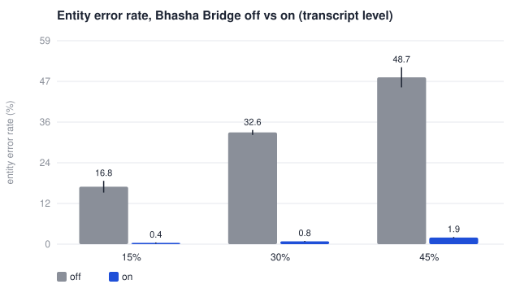<figcaption>Figure 1. Entity error rate on independently corrupted sentences, Bhasha Bridge off and on. Whiskers are 95% CIs over seeds.</figcaption></figure>

At 30% noise, 2,097 sentences carrying 2,862 catalogue entities go from 32.4% entity error to 0.71%, a 97.8% relative reduction, at 98.9% precision (the fraction of corrections that produced a gold entity). The improvement is not noise: on the paired per-sentence outcomes at 30% noise, 809 sentences go from wrong to right and 0 from right to wrong (McNemar p < 0.001; `research/harness/stats.py`). The harmful count, the number of times the layer overwrote a span the recogniser had right, is zero in every seed at every noise level; the confidence intervals on it are zero because the value never moved. The median cost of the pass is 0.07 ms per utterance. The residual error is almost entirely entities the corruption model damaged beyond edit distance 2, or whose corrupted form collided with no lexicon key, which the second condition correctly refuses to touch.

### 4.3 Results: end to end

**Table 2 — End-to-end calls under the same noise (Bhasha on vs off)**

| noise rate | calls | EER off (%) | EER on (%) | task success off (%) | task success on (%) | beneficial | neutral | harmful |
|---|---|---|---|---|---|---|---|---|
| 15% | 63 | 16.4 ± 8.3 | 0.0 ± 0.0 | 88.2 ± 5.9 | 96.5 ± 0.9 | 8.0 | 0.8 | 0.0 |
| 30% | 63 | 32.3 ± 8.0 | 0.0 ± 0.0 | 78.4 ± 8.7 | 92.7 ± 7.0 | 15.6 | 2.6 | 0.0 |
| 45% | 63 | 47.7 ± 2.9 | 0.0 ± 0.0 | 62.2 ± 4.5 | 84.4 ± 2.6 | 21.4 | 3.4 | 0.0 |

<figure>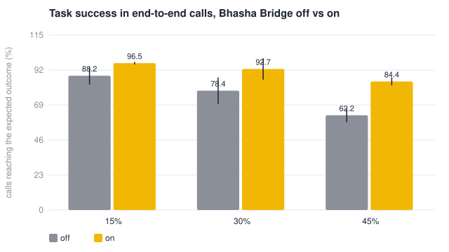<figcaption>Figure 2. Calls reaching their expected outcome under the same noise, Bhasha Bridge off and on.</figcaption></figure>

In full calls the same noise is applied to every caller turn and the dialogue has to survive it. Without the bridge, task success falls with noise, from 88.2% at 15% to 62.2% at 45%, because a mangled service name sends the policy down the wrong path or into a clarification the scripted caller does not answer. With it, success stays at 92.7% at 30% noise and 84.4% at 45%. The calls that still fail with the bridge on are ones where the corruption hit a word outside the lexicon that the policy nonetheless needed (a date word, a number), which the bridge rightly leaves alone; §9 discusses this.

**Table 3 — Per pack at 30% noise**

| pack | language | calls | task success off (%) | task success on (%) | EER off (%) | EER on (%) |
|---|---|---|---|---|---|---|
| clinic_kolkata | benglish | 9 | 75.6 ± 15.1 | 88.9 ± 16.9 | 36.7 ± 9.3 | 0.0 ± 0.0 |
| coaching_institute | hinglish | 9 | 82.2 ± 15.7 | 91.1 ± 15.1 | 26.7 ± 34.6 | 0.0 ± 0.0 |
| dental_clinic | hinglish | 24 | 70.0 ± 17.3 | 90.0 ± 8.6 | 34.4 ± 17.8 | 0.0 ± 0.0 |
| diagnostic_lab | hinglish | 9 | 91.1 ± 6.2 | 97.8 ± 6.2 | 20.0 ± 22.7 | 0.0 ± 0.0 |
| salon_spa | hinglish | 12 | 85.0 ± 8.7 | 98.3 ± 4.6 | 31.1 ± 15.1 | 0.0 ± 0.0 |

The per-pack view at 30% noise shows the mechanism is not tuned to the dental pack the demo uses: the Benglish pack gains as much as the Hinglish ones, from a lexicon that contains Bengali-English surface forms and the same key rules.

### 4.4 A recorded limitation

/b/ and /p/ merge for many speakers, so *braces* and *prices* land in one phonetic bucket and edit distance does not separate them either. In practice the confidence condition keeps this from mattering (a recogniser is rarely unsure of *prices*), and `test_a_known_collision_is_documented_not_hidden` exists so that the limitation cannot be quietly lost.

### 4.5 A real recogniser: pilot on synthetic Indian-English speech

The corruption model is the weakest link in the argument above, so the pipeline that replaces it was built and run before any volunteer was recorded (`research/collect/`). The prompt sentences of every pack (its scenario lines, then entity-bearing frames over its catalogue; 20 per pack) were read by the three Indian-English voices of macOS (`say`: Rishi, Aman, Tara) and transcribed by faster-whisper (`small`, CPU, decoded as English with no hints and no vocabulary), which is the kind of general recogniser Bhasha Bridge is meant to sit on top of. Whisper's per-word probabilities were used as the confidences. This is **synthetic speech through a real recogniser**: it measures real recognition errors on Indian-English synthesis, not on Indian callers, and every file it produced says so.

**Table 6 — 300 utterances, 219 catalogue entities, faster-whisper small, English decoding**

| bridge | WER (%) | EER off (%) | EER on (%) | reduction (%) | precision (%) | beneficial | neutral | harmful |
|---|---|---|---|---|---|---|---|---|
| as evaluated in §4.2 | 88.7 | 33.8 | 30.6 | 9.5 | 47.1 | 16 | 10 | **8** |
| with the guards below | 88.7 | 33.8 | 30.1 | 10.8 | 60.0 | 12 | 8 | **0** |

Three things the synthetic experiment could not show:

1. **The recogniser's dominant errors are not phonetic substitutions.** Word error rate is 89%: decoded as English, Whisper paraphrases or translates ("Jadavpur wali branch mein tooth extraction ka slot hai kya" became "Is there a slot for tooth extraction in the Jadavpuvali branch?") and merges words ("kal subah root canal" became "KAL SUBHAHROOT KANAL"). Two thirds of the catalogue entities nonetheless survive, because they are English words. The errors that do look like the corruption model's are repaired exactly as designed: *root kanal* → root canal, *giriahat* → Gariahat, *air cut* → haircut, *ms kulakrani* → Ms Kulkarni, *bhavan* → Bhawan, *anapurna* → Annapurna, *need* → NEET. Merged tokens and translated sentences are outside what token-level matching can repair; recogniser biasing, which this run deliberately did not use, is the lever for those.
2. **The confidence gate was open.** The median word probability was 0.62 and 80% of words fell below the 0.85 threshold, so condition 1 of §4.1 held almost everywhere and the layer's safety rested on condition 2 alone. Condition 2 alone is not safe: the bridge made 8 harmful corrections in 300 utterances, 22% of all the corrections it made. Six were *slot* → *Salt*: the Kolkata pack's locality "Salt Lake" contributes the fragment "Salt" to the lexicon, "slot" and "Salt" share the key `SRT`, and they are two edits apart. The others were *na* → *Neha* and *raha* → *Rau*, and a harmless but absurd *to do* → *thyroid profile* through the alias "t3 t4", whose key is `TT` once the digits are dropped.
3. **Three guards close this, and are stated as rules.** Words of the booking dialogue itself (*slot*, *time*, *book*, *branch*, *number*, *raha*, *chahiye*, …) are never corrected, by the same reasoning that already protected grammar words: they are never a tenant's entity, however close their sound key sits to one. A single token of fewer than four letters is never replaced on its own, and a lexicon form with fewer than four letters is never evidence for a replacement; the corruption model never touched such tokens either, which is why the synthetic experiment could not expose this. With the guards the harmful count is zero, precision rises to 60%, and the entity error reduction is 10.8% relative (33.8% → 30.1%). The guards cost three correct repairs of the three-letter surname *Rau* (*rao* → *Rau*). The synthetic results of §4.2 and §4.3 were regenerated with the guards in place; there they remove a handful of neutral corrections and nothing else, and every figure moved within its interval. Per voice the reduction ranges from 20% (Rishi) to none (Aman), on 73 entities each.

The honest summary is that on this data the bridge is safe and helps a little, not that it removes most entity errors as it does under the corruption model. The two numbers differ because the error distributions differ, and the pilot cannot say which one real callers produce: the synthesis is accented but not Hinglish, the recogniser was run in the configuration least favourable to it, and the guards were evaluated on the same 300 utterances that motivated them, so their gain is optimistic. What the pilot establishes is the pipeline itself, three failure modes the synthetic harness could not see, and that the confidence gate needs per-recogniser calibration before condition 1 can be trusted. Volunteer recordings through the same pipeline (§9) are the measurement that matters.

### 4.6 Against the classic keys

The key in §4.1 is one component; the two-condition rule, the edit-distance bound and the lexicon are the rest. To isolate it, the benchmark swaps only the bucketing function and keeps everything else: Soundex (Russell 1918), Metaphone and Double Metaphone (Philips 1990, 2000), NYSIIS, exact spelling (a bucket per spelling, so only identical strings collide), and no bucketing at all (every lexicon form is a candidate and the edit-distance bound alone decides). Each runs on the same 2,097 corrupted sentences per noise level and on the 300 pilot utterances. McNemar's test on the paired per-sentence outcomes (a sentence has an entity error or not) says whether two keyers differ by more than noise.

**Table 8 — Keyers on synthetic noise (transcript level, 2,097 sentences per rate)**

| keyer | EER on @15% | EER on @30% | EER on @45% | precision @30% | harmful @30% | McNemar vs ours @30% |
|---|---|---|---|---|---|---|
| edit distance only | 0.56% | 1.68% | 2.94% | 93.9% | 0 | b=32, c=7, p < 0.001 |
| exact spelling | 17.30% | 32.01% | 50.35% | 100.0% | 0 | b=807, c=0, p < 0.001 |
| Soundex | 2.48% | 3.98% | 7.09% | 98.5% | 0 | b=97, c=7, p < 0.001 |
| Metaphone | 3.77% | 8.04% | 14.29% | 98.5% | 0 | b=203, c=0, p < 0.001 |
| NYSIIS | 1.64% | 3.46% | 7.09% | 99.2% | 0 | b=82, c=7, p < 0.001 |
| Double Metaphone | 2.80% | 6.99% | 10.97% | 98.5% | 0 | b=175, c=0, p < 0.001 |
| Bhasha (ours) | 0.14% | 0.80% | 2.10% | 99.1% | 0 | — |

Entity error with no correction at 30%: 32.1% (identical for every keyer). Bridge off vs ours: b=809, c=0, p < 0.001.

**Table 9 — Keyers on the real-recogniser pilot (300 utterances, faster-whisper small)**

| keyer | EER off | EER on | reduction | precision | beneficial | neutral | harmful |
|---|---|---|---|---|---|---|---|
| edit distance only | 33.8% | 32.4% | 4.1% | 42.1% | 32 | 38 | 6 |
| exact spelling | 33.8% | 33.3% | 1.4% | 100.0% | 1 | 0 | 0 |
| Soundex | 33.8% | 30.6% | 9.5% | 68.4% | 13 | 6 | 0 |
| Metaphone | 33.8% | 31.5% | 6.8% | 64.7% | 11 | 6 | 0 |
| NYSIIS | 33.8% | 32.4% | 4.1% | 81.8% | 9 | 2 | 0 |
| Double Metaphone | 33.8% | 31.1% | 8.1% | 66.7% | 12 | 6 | 0 |
| Bhasha (ours) | 33.8% | 30.1% | 10.8% | 60.0% | 12 | 8 | 0 |

Two readings. On synthetic noise the Indic-aware key is clearly better than every classic key (0.80% entity error at 30% noise against 3.5–8.0%, every pairwise McNemar p < 0.001), and better than the edit-distance bound alone (1.68%; b = 32, c = 7, p < 0.001): bucketing does more than restrict the search, it finds forms that are two or three edits away but one sound away. Exact spelling repairs nothing, which is the point of a phonetic key. On the real-recogniser pilot the keys are within a point of each other (30.1% ours, 30.6% Soundex, 31.1% Double Metaphone) and Soundex's precision is higher (68% against 60%): where the recogniser's errors are translations and merged tokens rather than phonetic substitutions, the choice of key barely matters and the guards of §4.5 matter more. Both readings are reported because together they say what the key is for.

### 4.7 Which rules matter

Each of the 16 normalisation rules was removed in turn and the transcript-level experiment re-run at 30% noise.

**Table 10 — Per-rule ablation of the Bhasha key (30% noise; higher delta = the rule matters more)**

| # | rule | EER on without it | Δ vs full (points) | precision | harmful |
|---|---|---|---|---|---|
| 8 | k/kh/q/c merge | 2.97% | +2.17 | 99.0% | 0 |
| 4 | v/w merge | 2.52% | +1.72 | 98.5% | 0 |
| 15 | h/y dropped | 1.19% | +0.39 | 99.0% | 0 |
| 0 | long a shortens (aa→a) | 0.80% | +0.00 | 99.1% | 0 |
| 1 | ee/ie/ii/iy→i | 0.80% | +0.00 | 99.1% | 0 |
| 2 | oo/uu→u | 0.80% | +0.00 | 99.1% | 0 |
| 3 | ph→f | 0.80% | +0.00 | 99.1% | 0 |
| 5 | s/sh/z merge | 0.80% | +0.00 | 99.1% | 0 |
| 7 | t/d/th/dh collapse | 0.80% | +0.00 | 99.1% | 0 |
| 9 | surviving c→k | 0.80% | +0.00 | 99.1% | 0 |
| 10 | g/gh/j-cluster merge | 0.80% | +0.00 | 99.1% | 0 |
| 11 | b/bh/p merge | 0.80% | +0.00 | 99.1% | 0 |
| 12 | j | 0.80% | +0.00 | 99.1% | 0 |
| 13 | n/m merge | 0.80% | +0.00 | 99.1% | 0 |
| 14 | l/r merge | 0.80% | +0.00 | 99.1% | 0 |
| 6 | ch/chh merge | 0.52% | -0.28 | 99.1% | 0 |

Three rules carry the synthetic result: the k/kh/q/c merge (+2.17 points without it), the v/w merge (+1.72) and the dropped initial h (+0.39); removing the ch/chh merge slightly *helps* (-0.28), because it was merging forms the corpus kept distinct. The eleven rules with a zero delta are not thereby useless: they are not exercised by this corpus under this corruption model, which substitutes a fixed list of confusions on catalogue words. That is a statement about the harness's coverage as much as about the key, and it is one more reason the real-recording study matters: the rules a real recogniser exercises will differ, and this table will be re-run on that data.

## 5. Speculative Turn Execution

### 5.1 Method

By the time a caller has said "kal subah root canal ka…", it is nearly certain that the next thing needed is tomorrow morning's availability for root canal. The speculation engine (`speculation/engine.py`) receives every partial transcript, asks a cheap predictor for a tool guess, and if the guess is confident enough starts the tool immediately while the caller is still speaking. The predictor is deterministic triggers plus a tiny logistic scorer over bag-of-cue features; a language model here would cost more time than it could save.

The speed is easy; the correctness is the work, and it rests on four properties, each with a test that fails if it is weakened:

* **Purity.** Only tools declared `read_only` in the registry are ever speculated. The registry enforces it; the predictor is not trusted.
* **Argument identity.** A speculative result is claimed only when the real turn asks for byte-identical arguments. Both the predictor and the dialogue policy derive arguments through the same `nlu.py`, which makes the identity structural rather than lucky.
* **Freshness.** Results expire after 4 s and can be claimed exactly once.
* **Invalidation.** Any write voids every result computed against the old world.

A budget bounds the cost of wrong guesses: at most 2 speculations in flight, 3 per turn, and none before 3 words of partial transcript or below a predictor confidence of 0.60. `test_the_result_is_identical_with_speculation_on_and_off` asserts the strong form of the design goal: the transcript of a call must be identical whether speculation is on or off, because it is a latency optimisation and nothing else.

### 5.2 Results

**Table 4 — Ablation on the authored scenarios (clean transcripts)**

| configuration | task success (%) | EER (%) | read-turn p50 (ms) | read-turn p90 (ms) | write-turn p90 (ms) | all-tool p90 (ms) | spec. hit rate (%) | wasted | unconfirmed writes |
|---|---|---|---|---|---|---|---|---|---|
| full | 100.0 ± 0.0 | 0.0 ± 0.0 | 161 ± 22 | 270 ± 29 | 233 ± 33 | 251 ± 31 | 46.2 ± 0.0 | 42.0 | 0 |
| no_speculation | 100.0 ± 0.0 | 0.0 ± 0.0 | 286 ± 7 | 374 ± 13 | 228 ± 7 | 349 ± 10 | 0.0 ± 0.0 | 0.0 | 0 |
| no_bhasha | 66.7 ± 0.0 | 69.2 ± 0.0 | 194 ± 5 | 306 ± 16 | 226 ± 5 | 278 ± 18 | 21.7 ± 0.0 | 54.0 | 0 |
| baseline | 66.7 ± 0.0 | 69.2 ± 0.0 | 206 ± 3 | 332 ± 23 | 221 ± 18 | 306 ± 24 | 0.0 ± 0.0 | 0.0 | 0 |

<figure>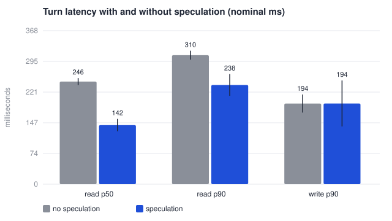<figcaption>Figure 3. Engine-side latency of read-only turns (p50, p90) and of write turns (p90), with and without speculation. Nominal milliseconds.</figcaption></figure>

On the authored scenarios with clean transcripts, every configuration with the bridge on reaches the expected outcome in 100.0% of calls, and the two bridge-off configurations fail 7 of the 21, every one of them a scenario whose hand-written corruption hits a catalogue entity (two more such scenarios survive because the dialogue happens to tolerate that particular mangling). Speculation changes no outcome and no transcript. It lowers the median latency of read-only turns from 286 ms to 161 ms (43.8% lower) and the p90 from 374 ms to 270 ms, at a hit rate of 46.2% over 78 speculations per run, saving 250 ms per hit. About 42 speculations per run are wasted, bounded by the budget.

Three things in the table are reported rather than averaged away. First, write turns are never speculated, so the booking turn itself is not faster: its p90 is 228 ms without speculation and 233 ms with it, and it still waits for the caller's confirmation and the ledger. The p90 over *all* tool turns does fall (349 → 251 ms) only because most tool turns in a booking call are reads. Second, the hit rate is well under 100%: the predictor fires on partials that turn out to want a different date or no tool at all. Third, the two runtime contributions interact: with the bridge off, the hit rate drops to 21.7%, because the predictor derives its arguments from the same mangled entities the policy does, and the real turn then asks for something else. The second and third are the expected shape of a correct speculation scheme, and the second is the quantity a learned predictor trained on real calls would improve.

### 5.3 Concurrency

Speculation and the policy are measured per call above; a receptionist also has to answer several callers at once. `research/harness/load_test.py` starts one engine process (mock providers, rate limiting off) and drives scripted callers through the web-call API with a short random pause between turns, for a ladder of concurrency levels, measuring the HTTP round-trip of each turn — what a browser or a telephony bridge would wait for.

**Table 7 — one process, scripted callers, 21 scripts across the five packs**

| concurrent callers | calls | turns | p50 (ms) | p95 (ms) | max (ms) | calls/min | errors | expected outcome |
|---|---|---|---|---|---|---|---|---|
| 5 | 60 | 160 | 7.0 | 187.0 | 190.1 | 467 | 0 | 97% |
| 10 | 60 | 160 | 5.0 | 185.2 | 189.8 | 890 | 0 | 95% |
| 25 | 60 | 154 | 4.6 | 184.6 | 193.6 | 1578 | 0 | 83% |
| 50 | 60 | 154 | 6.2 | 185.8 | 189.2 | 2548 | 0 | 70% |

<figure>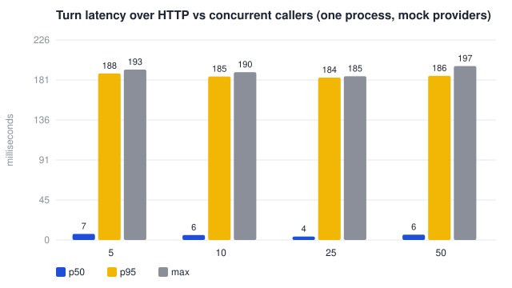<figcaption>Figure 4. Turn latency over HTTP (p50, p95, max) as concurrency rises. One process; the p95 is the booking turn's write and ledger seal.</figcaption></figure>

Latency is flat across the ladder and no request fails; throughput scales with concurrency because the engine's own work per turn is a few milliseconds and the rest is waiting. The expected-outcome rate falls because all callers in a level share one tenant calendar and ask for the same morning: once it is full the agent correctly offers another time or takes a callback, which the fixed script does not follow, so those calls end abandoned or as leads. That is the calendar working, not the engine failing, and it is why the column is reported next to the error count rather than folded into it. The numbers are engine-side; a speech vendor's round trip and a telephony hop will dominate a deployment, and this measurement says only that the engine will not be the bottleneck before them.

## 6. Pramaan Ledger

### 6.1 Method

Every write (`book_appointment`, `cancel_appointment`, `capture_lead`, `handoff`) produces a receipt containing the action and its arguments, a *confirmation proof* (the exact sentence the agent asked, the exact words the caller replied, when each began, the offset between them, and the recogniser's confidence in the reply), a redacted transcript excerpt, the pack version, and a timestamp. The payload hash is SHA-256 over the canonical JSON (sorted keys, no insignificant whitespace, RFC 8785 in spirit) of those fields; the chain hash is SHA-256 over the previous chain hash and the payload hash; the chain hash is signed with the tenant's Ed25519 key. A day's receipts are anchored by a signed Merkle root. The receipt's short code (the first eight hex digits of the chain hash) is what the agent reads to the caller: "Confirmation code 2504-7863".

Two consequences follow that a log file cannot give:

* **The ledger refuses an unconfirmed write.** Appending with no confirmation proof raises inside the transaction, which rolls back, and no booking exists. This is enforced in the ledger, below the dialogue policy, so a policy bug (or a hosted model's hallucinated tool call, §7) cannot book something the caller did not agree to.
* **Anyone can check it.** The export endpoint returns receipts and the public key and nothing else. `haanji verify` and the public `/verify` page re-derive every hash and check every signature without trusting the platform; the page has a *tamper* button so a visitor can watch the chain break.

### 6.2 Results

**Table 5 — Pramaan Ledger under attack (deterministic)**

| attack | attempted | detected |
|---|---|---|
| mutate `action_args.time` | 10 | 10 |
| mutate `action_args.service` | 10 | 10 |
| mutate `action_args.phone` | 10 | 10 |
| mutate `confirmation.reply_text` | 10 | 10 |
| mutate `confirmation.asr_confidence` | 10 | 10 |
| mutate `transcript_excerpt` | 10 | 10 |
| mutate `occurred_at` | 10 | 10 |
| mutate `agent_config_version` | 10 | 10 |
| delete a receipt from the middle | 1 | 1 |
| forge a receipt and re-hash it | 1 | 1 |
| write without a confirmation proof | 1 | 1 |

The experiment seals a chain of 40 real bookings, then attacks it: each of eight fields is mutated in ten receipts; a receipt is deleted from the middle; a receipt is forged and conscientiously re-hashed so that its own hashes are consistent; and a write with no proof is attempted. Every mutation is caught at the payload hash, the deletion at the chain hash, the forgery at the signature, and the unconfirmed write at the ledger's door. The end-to-end harness additionally scans every backend after every call for a confirmed booking without a receipt code and found none in any configuration or seed (Table 4, last column). These results are deterministic and are reported without intervals.

## 7. Dialogue: a deterministic policy, and a hosted model behind the same boundary

The policy in §3.3 answers every call in the evaluation above. It was chosen for auditability and speed, and its limitation is obvious: it understands the phrasings its authors anticipated. To measure what a hosted model buys and costs, the engine's dialogue boundary was made real (both halves of a turn, planning and reacting to tool results, go through one `respond()` call) and an adapter for Claude (`claude-opus-4-8`) was written behind it with three properties:

* **The model never decides a write.** A request to book or cancel is intercepted and turned into the pack's own read-back question; the caller's "haan" is then handled by the deterministic policy, which is the only path that produces a tool call the ledger will accept. The write path is therefore identical with or without the model, and the ledger's guarantee does not depend on prompt quality.
* **Vendor failure falls back to the policy for that turn**, so a call never dies because an API did.
* **Guardrails and speculation are unchanged.** Speculation's predictor derives arguments through `nlu.py`; the model's arguments will often differ, so the hit rate is expected to fall, and this is measured rather than hidden.

The adapter is validated offline with a scripted stand-in for the API (ten tests: text replies, a read-only round trip with matching tool-use ids, a write turned into the confirmation question, a confirmed yes producing a receipt while the model is not consulted, end-of-call, fallback). The ablation harness `research/harness/llm_ablation.py` runs the 21 scenarios under both adapters:

| | deterministic policy (`mock`) | Claude (`claude`) |
|---|---|---|
| scenarios reaching expected outcome | 21/21 | *not yet run* |
| receipts written | 16 | — |
| turn latency p50 / p95, engine-side (ms) | 32 / 176 | — |
| speculation hits / started | 12/26 | — |
| adapter calls / fallbacks | 81 / 0 | — |

The Claude column is empty in this version of the report because the run requires an API key and had not been executed when the report was generated; the harness skips it with a note rather than inventing a number. The column will be filled in version 1.1 with the same script. What the design already guarantees, independent of that run, is that the receipts column will be produced by the same code path and the unconfirmed-writes count will be zero.

## 8. Threats to validity

**Construct.** Entity error rate is defined over the catalogue entities the pack declares; a recogniser error in a date word or a phone number is invisible to it, though not to task success, which is why both are reported. "Task success" is agreement with the outcome the scenario author expected, which for handoffs and refusals is the right behaviour, not a booking.

**Internal.** The corruption model is a model: it reproduces the substitutions Indian-English recognisers make, in the directions they make them, but it was written by the same team as the correction layer. We mitigated this by making it corrupt words outside every lexicon and by counting harmful corrections explicitly; the zero harmful count under it is evidence the layer is conservative on that distribution, and §4.5 shows it was not conservative on a real recogniser's distribution until two of its assumptions (calibrated confidence, no very short tokens) were made explicit. The guards were then evaluated on the data that motivated them. Scenarios are scripted, so a clarification question the caller "does not answer" counts as a failure the way a real caller would not. Speculation is measured against the mock recogniser's partials, which arrive at a realistic word rate but with no real acoustic uncertainty.

**External.** All latencies are engine-side, under simulated time, on one machine: they measure what HaanJi adds and what speculation removes, not vendor round-trip time, which in a deployment will dominate. No real audio was recognised and no real caller was involved in any number above; the browser demo and the WhatsApp channel have handled real text and speech, but informally. Five packs and 21 scenarios are a small, author-written sample of Indian small businesses.

**Statistical.** Confidence intervals are over 5 seeds with 3 repetitions each, using the t-distribution; with so few seeds the intervals are honest but wide, and a difference whose intervals overlap should be read as "not separated by this experiment". Several quantities (harmful corrections, unconfirmed writes, ledger detections) have zero variance because they never moved; that is the design working, not a statistical artefact, and it is why they are also covered by tests that fail if they change.

## 9. Limitations and future work

1. **Real recordings.** The pipeline is in place (`research/collect/`): a recording page (`/record`) that walks a volunteer through the pack's prompt sentences, a transcription script over a local Whisper model, and the same entity-error scoring over the resulting (heard, truth) pairs. §4.5 reports a pilot on synthetic Indian-English speech; what remains is 50–100 utterances from volunteers. If the entity error reduction holds on recorded callers the claim becomes a paper-grade one; if it does not, that is the finding.
2. **Real users.** The study kit is in place: a protocol (`docs/study/protocol.md`), a participant page (`/study`) with consent, three timed task cards and the System Usability Scale (Brooke 1996) in Hinglish, and an analysis script that reports task success with Wilson intervals and SUS with a t-interval. The study itself (8–10 participants) has not been run.
3. **The hosted-model ablation** (§7) with the key in place, including the speculation hit rate under model-derived arguments and a token-cost line.
4. **Out-of-lexicon failures.** The calls that still fail under noise are ones where a date or number word was corrupted. A separate, small closed-vocabulary repair for dates, times and numbers, with the same two-condition rule, is the obvious next layer.
5. **Telephony.** The live demo uses the browser's recogniser and a WhatsApp text channel; a PSTN trunk with streaming recognition and synthesis is the remaining integration, and vendor latency is the quantity to measure there.
6. **A learned predictor.** The speculation hit rate (46.2%) is the headroom; a predictor trained on logged partials would raise it without touching the correctness properties.

## 10. Conclusion

A voice receptionist for Indian small businesses fails for three specific reasons: it does not know the business's words, it is slow at the turn, and it cannot prove what was agreed. HaanJi addresses each with a mechanism that is small, inspectable and measured. Bhasha Bridge removes most catalogue entity errors under heavy synthetic noise without damaging a correct transcript, and the gain survives into end-to-end task success and into a second language; on a real recogniser's output it needed two more stated rules to stay safe and then helped far less, which is the measurement that sends the next piece of work to volunteers' recordings rather than to more synthetic noise. Speculative Turn Execution takes a large fraction off the median read-turn latency while leaving every transcript identical. The Pramaan Ledger makes every booking carry its own evidence and makes an unconfirmed booking impossible rather than unlikely, a property that holds whether the dialogue is driven by the deterministic policy or by a hosted model. The evaluation is reproducible from a clean checkout and is honest about its synthetic origins; the next two studies replace synthetic noise with real recordings and scripted callers with real ones.

## References

<div class="refs" markdown="1">

Bali, K., Sharma, J., Choudhury, M., and Vyas, Y. (2014). "I am borrowing ya mixing?" An analysis of English-Hindi code mixing in Facebook. *Proceedings of the First Workshop on Computational Approaches to Code Switching*, EMNLP 2014.

Bernstein, D. J., Duif, N., Lange, T., Schwabe, P., and Yang, B.-Y. (2012). High-speed high-security signatures. *Journal of Cryptographic Engineering*, 2(2), 77–89.

Bohus, D., and Rudnicky, A. I. (2005). Sorry, I didn't catch that! An investigation of non-understanding errors and recovery strategies. *Proceedings of the 6th SIGdial Workshop on Discourse and Dialogue*.

Brooke, J. (1996). SUS: A "quick and dirty" usability scale. In P. W. Jordan et al. (eds.), *Usability Evaluation in Industry*. Taylor & Francis.

Budzianowski, P., Wen, T.-H., Tseng, B.-H., Casanueva, I., Ultes, S., Ramadan, O., and Gašić, M. (2018). MultiWOZ: A large-scale multi-domain Wizard-of-Oz dataset for task-oriented dialogue modelling. *Proceedings of EMNLP 2018*.

Chen, C., Borgeaud, S., Irving, G., Lespiau, J.-B., Sifre, L., and Jumper, J. (2023). Accelerating large language model decoding with speculative sampling. arXiv:2302.01318.

Haber, S., and Stornetta, W. S. (1991). How to time-stamp a digital document. *Journal of Cryptology*, 3(2), 99–111.

Hennessy, J. L., and Patterson, D. A. (2017). *Computer Architecture: A Quantitative Approach* (6th ed.). Morgan Kaufmann.

Javed, T., Joshi, S., Nagarajan, V., et al. (2023). Svarah: Evaluating English ASR systems on Indian accents. *Proceedings of Interspeech 2023*.

Javed, T., Nawale, J. A., George, E. G., et al. (2024). IndicVoices: Towards building an inclusive multilingual speech dataset for Indian languages. *Findings of the Association for Computational Linguistics: ACL 2024*.

Laurie, B., Langley, A., and Kasper, E. (2013). Certificate Transparency. RFC 6962, IETF.

Levenshtein, V. I. (1966). Binary codes capable of correcting deletions, insertions, and reversals. *Soviet Physics Doklady*, 10(8), 707–710.

Leviathan, Y., Kalman, M., and Matias, Y. (2023). Fast inference from transformers via speculative decoding. *Proceedings of the 40th International Conference on Machine Learning (ICML 2023)*.

Merkle, R. C. (1987). A digital signature based on a conventional encryption function. *Advances in Cryptology, CRYPTO '87*, LNCS 293, 369–378.

Philips, L. (1990). Hanging on the Metaphone. *Computer Language*, 7(12), 39–43.

Philips, L. (2000). The Double Metaphone search algorithm. *C/C++ Users Journal*, 18(6).

Pundak, G., Sainath, T. N., Prabhavalkar, R., Kannan, A., and Zhao, D. (2018). Deep context: End-to-end contextual speech recognition. *Proceedings of the IEEE Spoken Language Technology Workshop (SLT 2018)*.

Radford, A., Kim, J. W., Xu, T., Brockman, G., McLeavey, C., and Sutskever, I. (2023). Robust speech recognition via large-scale weak supervision. *Proceedings of ICML 2023*.

Rundgren, A., Jordan, B., and Erdtman, S. (2020). JSON Canonicalization Scheme (JCS). RFC 8785, IETF.

Russell, R. C. (1918). Index. U.S. Patent 1,261,167.

Skantze, G. (2005). Exploring human error recovery strategies: Implications for spoken dialogue systems. *Speech Communication*, 45(3), 325–341.

Zhao, D., Sainath, T. N., Rybach, D., Rondon, P., Bhatia, D., Li, B., and Pang, R. (2019). Shallow-fusion end-to-end contextual biasing. *Proceedings of Interspeech 2019*.

</div>

## Appendix A. Reproducing every number

```bash
git clone https://github.com/aritra-25hazra/haanji && cd haanji/engine
python3.11 -m venv .venv && source .venv/bin/activate
pip install -e ".[dev,web,llm]"
pytest -q                                   # 223 tests, about 4 s
python -m haanji.cli selftest               # 21 scenarios reach their expected outcome
python -m haanji.bench --reps 5 --speed 90  # research/results.json, about 3 min
cd .. && python research/harness/report_data.py --seeds 5 --reps 3 --speed 90
                                            # report_data.json, report_tables.md, figures/
python research/harness/llm_ablation.py     # needs ANTHROPIC_API_KEY for the claude half
python research/collect/synth.py && python research/collect/transcribe.py --manifest research/collect/data/synthetic/manifest.jsonl --out research/collect/data/synthetic/pairs.jsonl && python research/collect/evaluate.py --pairs research/collect/data/synthetic/pairs.jsonl
                                            # the §4.5 pilot (macOS voices, faster-whisper)
python research/harness/report_pdf.py       # this document as PDF
```

## Appendix B. The packaged scenarios

| pack | scenario | expected outcome | caller turns | what it exercises |
|---|---|---|---|---|
| dental_clinic | booking_with_asr_noise | BOOKED | 5 | service and locality mangled by the recogniser |
| dental_clinic | price_question_then_book | BOOKED | 5 | FAQ followed by a booking in one call |
| dental_clinic | faq_only | FAQ_ANSWERED | 2 | knowledge base, no booking |
| dental_clinic | emergency_handoff | HANDED_OFF | 1 | guardrail: emergency leaves automation at once |
| dental_clinic | medical_advice_refusal | HANDED_OFF | 1 | guardrail: the agent must not diagnose |
| dental_clinic | no_slot_lead_capture | LEAD_CAPTURED | 2 | closed day; a missed booking becomes a lead |
| dental_clinic | caller_interrupts | BOOKED | 4 | barge-in; synthesis stops mid-sentence |
| dental_clinic | doctor_by_name | BOOKED | 5 | "Dr Sheikh" heard as "Shaikh"; the staff list repairs it |
| salon_spa | colour_booking | BOOKED | 4 | multi-word service, staff preference |
| salon_spa | monday_closed_lead | LEAD_CAPTURED | 2 | weekly closure |
| salon_spa | price_faq | FAQ_ANSWERED | 2 | catalogue price |
| salon_spa | complaint_handoff | HANDED_OFF | 1 | escalation rule |
| diagnostic_lab | fasting_test_booking | BOOKED | 4 | prep note read back with the slot |
| diagnostic_lab | report_interpretation_refusal | HANDED_OFF | 1 | guardrail: no interpretation of results |
| diagnostic_lab | fasting_faq | FAQ_ANSWERED | 2 | knowledge base |
| coaching_institute | demo_booking | BOOKED | 4 | demo-class booking |
| coaching_institute | fee_faq | FAQ_ANSWERED | 2 | fees from the catalogue |
| coaching_institute | rank_promise_refusal | HANDED_OFF | 1 | guardrail: no guarantees |
| clinic_kolkata | benglish_booking_with_noise | BOOKED | 4 | Benglish; service mangled, repaired from the lexicon |
| clinic_kolkata | benglish_price_faq | FAQ_ANSWERED | 2 | Benglish knowledge base |
| clinic_kolkata | benglish_emergency | HANDED_OFF | 1 | Benglish guardrail |

## Appendix C. Test inventory (223 tests)

| file | tests | what it guards |
|---|---|---|
| test_pipeline.py | 31 | the turn controller, barge-in, confirmation flow, receipts per call, speculation on/off identity |
| test_packs.py | 25 | every pack validates and every scenario reaches its outcome |
| test_phonetics.py | 24 | each key rule, the known b/p collision |
| test_backend_guardrails.py | 24 | availability, bookings, guardrail subject/qualifier pairs |
| test_web.py | 26 | the demo server, design tokens, relative URLs, no emoji (every page, including the research pages) |
| test_pramaan.py | 19 | chain, signatures, refusal of unconfirmed writes, verifier, daily anchor |
| test_bhasha.py | 22 | the two-condition rule, name protection, harmful-correction detection, the pilot's guards |
| test_speculation.py | 14 | purity, argument identity, freshness, invalidation, budget |
| test_claude_adapter.py | 10 | the hosted-model adapter and its confirmation gate |
| test_research_kit.py | 8 | the recording page, the study page, scoring of real recogniser pairs |
| test_whatsapp_webhook.py | 9 | Meta signature, dedup, handshake |
| test_text_channels.py | 6 | the WhatsApp simulator and text turns |
| test_benglish.py | 3 | the second language end to end |
| test_study_analysis.py | 2 | the study summary arithmetic |

## Appendix D. Diagrams

The system as a reader of the code expects to see it drawn. (Also at `docs/diagrams.md`.)

The system as examiners expect to see it: context, containers, a booking turn,
the data, the data flow, the classes that matter, and the deployment. All
Mermaid, so they render on GitHub and in the PDF report.

### C4 — context

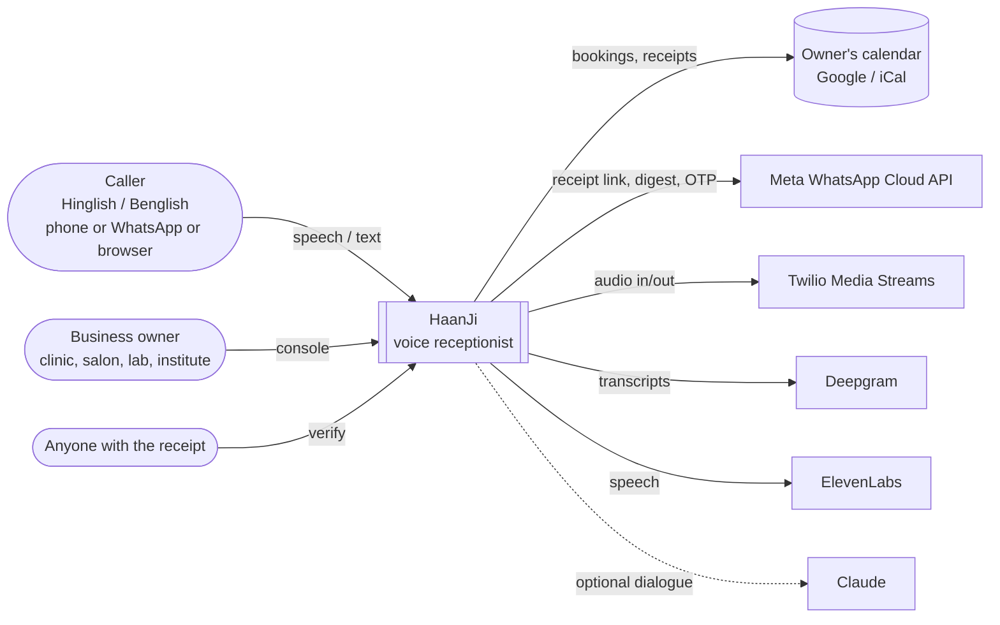

### C4 — containers

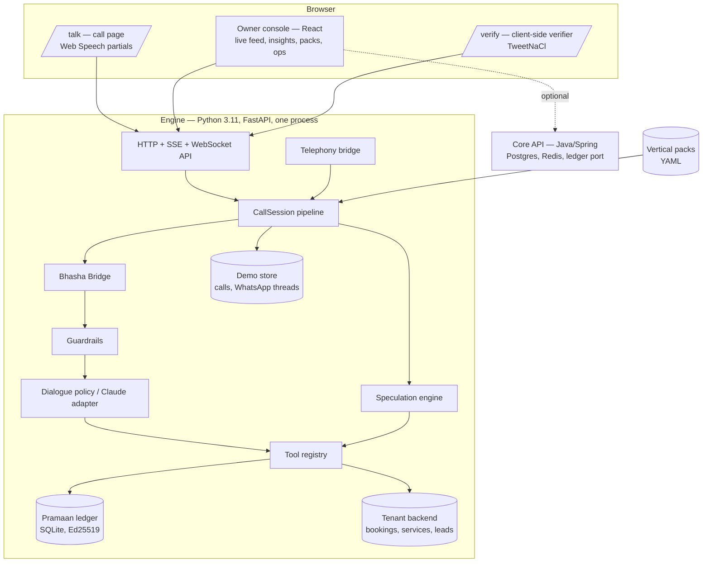

### Sequence — one booking turn (speculation, correction, confirmation, receipt)

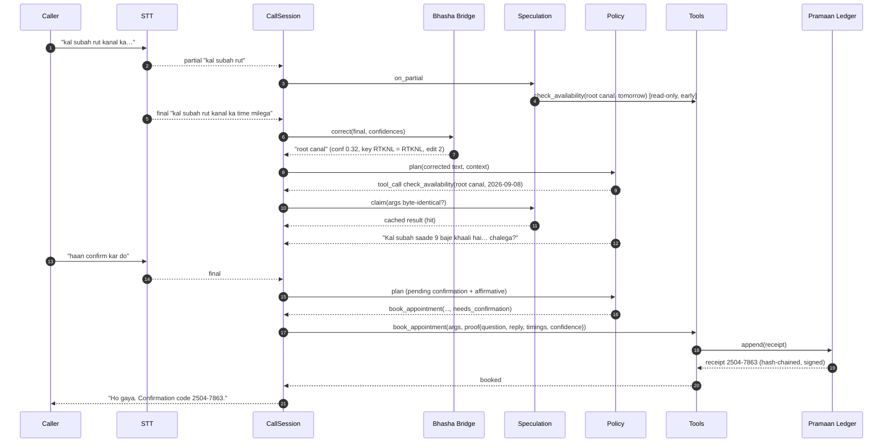

### ER — the data

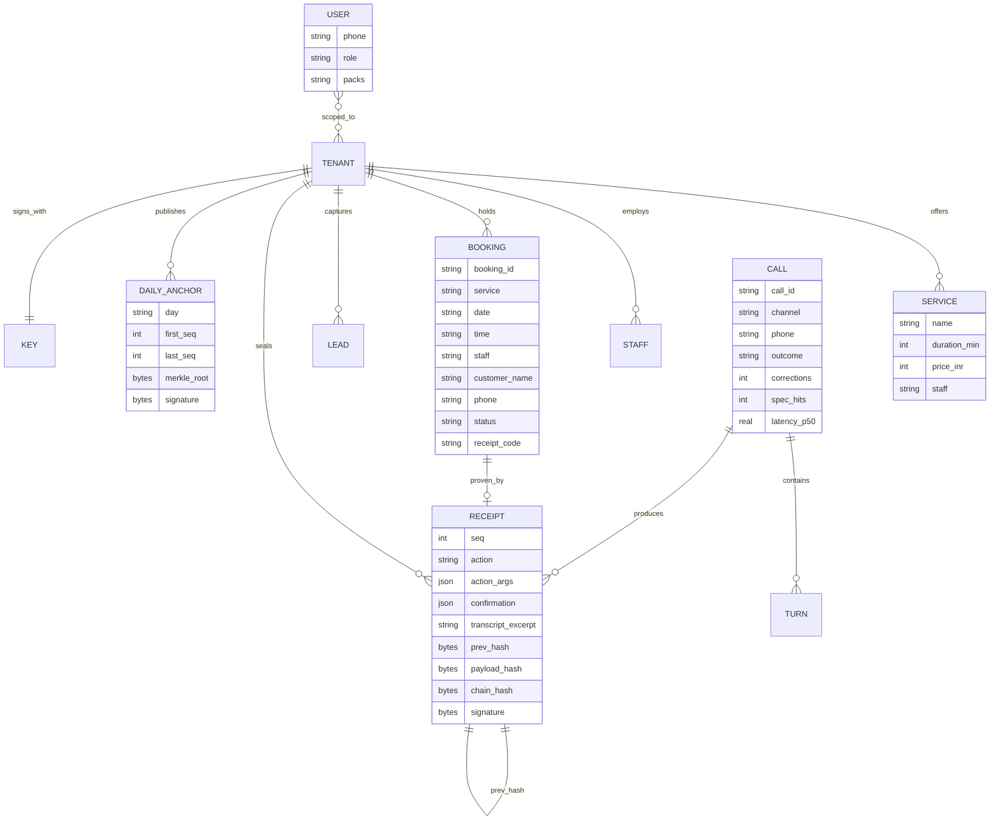

### DFD — level 0 and level 1

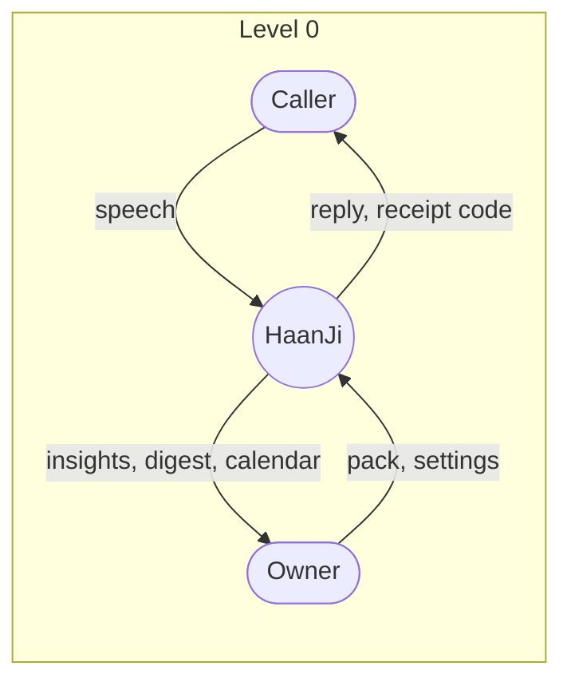

```mermaid
flowchart LR
  subgraph L1[Level 1 — one turn]
    a[(1.0 recognise)] --> b[(2.0 correct\nBhasha Bridge)]
    a -. partials .-> x[(3.0 speculate)]
    b --> g[(4.0 guard)]
    g --> d[(5.0 decide\npolicy / model)]
    d --> t[(6.0 execute tools)]
    x --> t
    t -->|write| l[(7.0 seal receipt)]
    d --> s[(8.0 speak)]
    D1[(lexicon)] --> b
    D2[(backend)] <--> t
    D3[(ledger)] <--> l
    D4[(call store)] <-- s
  end
```

### Class diagram — the engine's core

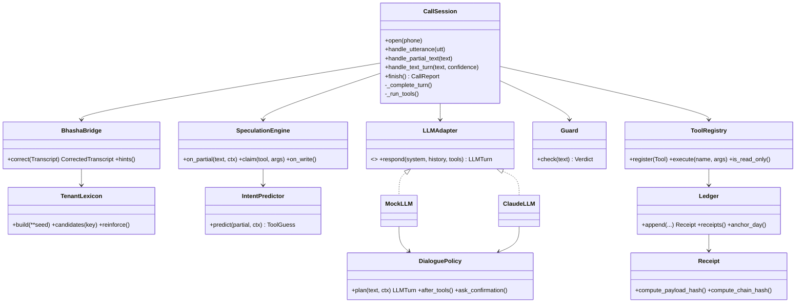

### Deployment

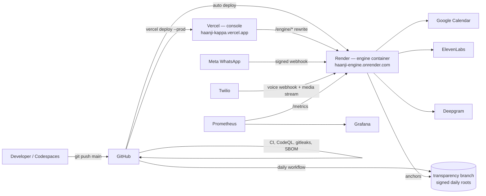

